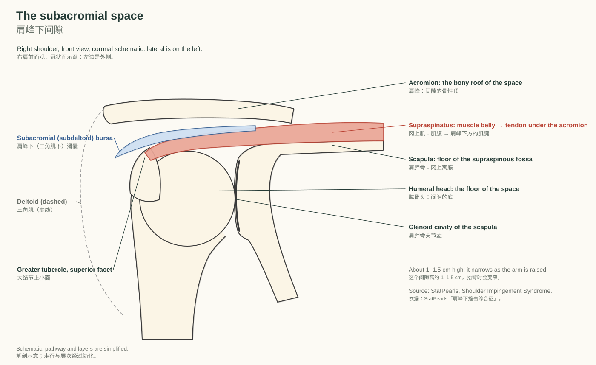
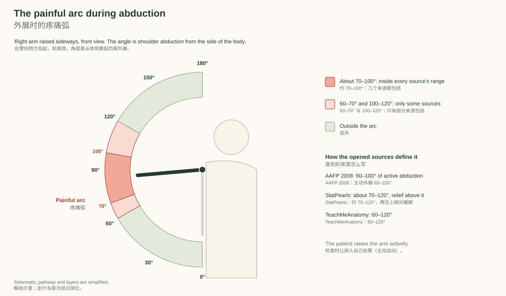
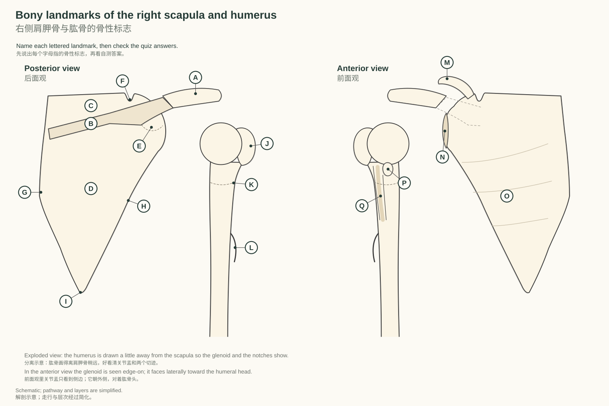

# 第 1 周 周二｜肩峰下疼痛综合征：从检查到治疗 · 骨性标志

DPT 基础 · 2026-10-13 · Subacromial pain syndrome, from assessment to treatment · bony landmarks

## 01 New: subacromial pain syndrome, from assessment to treatment

新内容：肩峰下疼痛综合征，从检查到治疗

> **After this chapter you can｜读完本章，你能够**
> 1. Define subacromial pain syndrome and name what lies in the subacromial space. 说出肩峰下疼痛综合征的定义，以及肩峰下间隙里有什么结构。
> 2. Walk through the six steps from history to return to activity, with a source for each step. 按六步走完从问诊到恢复活动的流程，每一步说得出依据。
> 3. Recognise the findings that point away from subacromial pain and the signs that need referral. 认出提示不是肩峰下疼痛的表现，以及需要转诊的信号。
> 4. Explain why exercise comes first and where the evidence is still unsettled. 说明为什么运动治疗排在前面，以及哪些地方证据还没有定论。
>
> **Key terms｜关键词：** Subacromial pain syndrome（肩峰下疼痛综合征） `sub-uh-KROH-mee-uhl PAYN SIN-drohm` /ˌsʌbəˈkroʊmiəl peɪn ˈsɪnˌdroʊm/ · Subacromial space（肩峰下间隙） `sub-uh-KROH-mee-uhl SPAYS` /ˌsʌbəˈkroʊmiəl speɪs/ · Subacromial bursa（肩峰下滑囊） `sub-uh-KROH-mee-uhl BUR-suh` /ˌsʌbəˈkroʊmiəl ˈbɝsə/ · Subacromial impingement（肩峰下撞击） `sub-uh-KROH-mee-uhl im-PINJ-muhnt` /ˌsʌbəˈkroʊmiəl ɪmˈpɪndʒmənt/ · Rotator cuff tendinopathy（肩袖肌腱病） `ROH-tay-ter KUF ten-duh-NAH-puh-thee` /ˈroʊˌteɪtər kʌf ˌtɛndəˈnɑpəθi/ · Painful arc（疼痛弧） `PAYN-fuhl AHRK` /ˈpeɪnfəl ɑrk/ · Palpation（触诊） `pal-PAY-shuhn` /pælˈpeɪʃən/ · Adhesive capsulitis（粘连性关节囊炎） `ad-HEE-siv kap-suh-LYE-tuhs` /ædˈhisɪv ˌkæpsəˈlaɪtəs/ · Glenohumeral osteoarthritis（盂肱关节骨关节炎） `glen-oh-HYOO-muh-ruhl ah-stee-oh-ahr-THRY-tis` /ˌɡlɛnoʊˈhjumərəl ˌɑstioʊɑrˈθraɪtɪs/ · Cervical radiculopathy（颈神经根病） `SUR-vih-kuhl ruh-dik-yuh-LAH-puh-thee` /ˈsɝvɪkəl rəˌdɪkjəˈlɑpəθi/ · Corticosteroid injection（皮质类固醇注射） `kor-tuh-koh-STER-oyd in-JEK-shuhn` /ˌkɔrtəkoʊˈstɛrɔɪd ɪnˈdʒɛkʃən/ · Subacromial decompression（肩峰下减压术） `sub-uh-KROH-mee-uhl dee-kuhm-PRESH-uhn` /ˌsʌbəˈkroʊmiəl ˌdikəmˈprɛʃən/ · Dry needling（干针） `DRY NEED-ling` /draɪ ˈnidlɪŋ/

Subacromial pain syndrome (SAPS) is the Dutch guideline's name for non-traumatic, usually one-sided shoulder pain located around the [acromion](http://127.0.0.1:5178/?term=acromion) that often gets worse during or after lifting the arm (Diercks 2014). It is an umbrella diagnosis: bursitis, calcific tendinosis, [supraspinatus](http://127.0.0.1:5178/?term=supraspinatus) tendinopathy, partial cuff tears, biceps tendinitis and cuff degeneration all sit under it. Lewis (2016) uses a wider umbrella, rotator cuff related shoulder pain (RCRSP), which also covers symptomatic full-thickness tears. You will meet both names, and the older word impingement, in papers and referral letters.

肩峰下疼痛综合征（SAPS）是荷兰指南的叫法：非外伤性、通常单侧、位于肩峰周围的肩痛，抬臂时或抬臂后常加重（Diercks 2014）。它是一个统称：滑囊炎、钙化性肌腱病、冈上肌腱病、肩袖部分撕裂、肱二头肌腱炎和肩袖退变都归在里面。Lewis（2016）用的统称更宽，叫肩袖相关肩痛（RCRSP），还包括有症状的全层撕裂。论文和转诊单里这两个名字都会见到，还有旧称“撞击”（impingement）。

*The subacromial space in a coronal schematic. The [acromion](http://127.0.0.1:5178/?term=acromion) is the bony roof; together with the acromioclavicular joint and the coracoacromial ligament (not drawn) it bounds the space from above and in front, and the [humeral head](http://127.0.0.1:5178/?term=humeral-head) is the floor. The [supraspinatus](http://127.0.0.1:5178/?term=supraspinatus) tendon and the subacromial (subdeltoid) bursa are drawn; parts of the [infraspinatus](http://127.0.0.1:5178/?term=infraspinatus) and [subscapularis](http://127.0.0.1:5178/?term=subscapularis) tendons and the long head of biceps tendon also lie in the space but are not drawn.*  
*肩峰下间隙的冠状面示意。肩峰是骨性的顶，它和肩锁关节、喙肩韧带（图中未画）一起从上方和前方围成这个间隙，肱骨头是底。图中画了冈上肌腱和肩峰下（三角肌下）滑囊；冈下肌腱和肩胛下肌腱的一部分、肱二头肌长头腱也在这个间隙里，没有画出。*

The space is typically 1 to 1.5 cm high and narrows normally during abduction and forward flexion; superior migration of the [humeral head](http://127.0.0.1:5178/?term=humeral-head), or too little scapular upward rotation and posterior tilt, narrows it further (StatPearls). The [supraspinatus](http://127.0.0.1:5178/?term=supraspinatus) tendon runs under the [acromion](http://127.0.0.1:5178/?term=acromion) to the superior facet of the [greater tubercle](http://127.0.0.1:5178/?term=greater-tubercle), and the subacromial bursa separates it from the coracoacromial ligament, the [acromion](http://127.0.0.1:5178/?term=acromion) and the [deltoid](http://127.0.0.1:5178/?term=deltoid) (Kenhub). The part of the bursa that extends laterally deep to the [deltoid](http://127.0.0.1:5178/?term=deltoid) is usually called the subdeltoid bursa.

这个间隙通常高 1–1.5 cm，外展和前屈时本来就会变窄；肱骨头上移，或肩胛骨上回旋和后倾不够，会让它更窄（StatPearls）。冈上肌腱从肩峰下方走到大结节上小面，肩峰下滑囊把它和喙肩韧带、肩峰、三角肌隔开（Kenhub）。滑囊向外延伸到三角肌深面的部分，通常叫三角肌下滑囊。

### The pathway in six steps｜六步流程

1. **History: what the patient tells you｜主诉与问诊**：The typical story is pain around the upper arm that came on gradually, is made worse by shoulder-level or overhead activities, and followed no trauma (BESS 2025). The [deltoid](http://127.0.0.1:5178/?term=deltoid) region is the area patients report most often (Requejo-Salinas 2022), and pain from the rotator cuff usually spreads no farther than the elbow (AAFP 2008). Ask about sleep and night pain, how easily the pain flares and how long it lasts once provoked; Lewis (2016) calls a shoulder that flares easily, stays painful for a long time and hurts at night irritable. 典型主诉是：上臂周围的疼痛逐渐出现，做到与肩同高或过头的动作时加重，之前没有外伤（BESS 2025）。病人最常指出的疼痛部位是三角肌区（Requejo-Salinas 2022）；肩袖来源的疼痛通常不超过肘部（AAFP 2008）。要问睡眠和夜间痛，问疼痛多容易被诱发、诱发后持续多久；Lewis（2016）把容易诱发、持续时间长、夜里也痛的情况称为“易激惹型”。
2. **Observation and palpation｜观察与触诊**：Watch both arms rise together. The Dutch guideline says that judging range of motion by eye is useful only for comparing the painful side with the other side (Diercks 2014). Palpate around the [acromion](http://127.0.0.1:5178/?term=acromion): subacromial tenderness may suggest rotator cuff pathology (AAFP 2008), while pain localised to the acromioclavicular joint with tenderness there points to that joint (BESS/BOA 2014). The opened guidelines give no other palpation findings for subacromial pain. 看双臂一起抬起。荷兰指南指出，目测关节活动度只适合拿患侧和健侧比较（Diercks 2014）。在肩峰周围触诊：肩峰下压痛可能提示肩袖病变（AAFP 2008）；疼痛局限在肩锁关节并有压痛，则指向肩锁关节（BESS/BOA 2014）。查到的指南没有给出肩峰下疼痛的其他触诊表现。
3. **Range of motion, strength and special tests｜关节活动度、肌力与特殊检查**：Compare active with passive range. In rotator cuff pathology, active range is often lost while passive range is relatively preserved (AAFP 2008), and subacromial pain usually comes with full passive range of the glenohumeral joint (Kulkarni 2015). Test the painful arc (figure 02) and resisted strength against the other side. BESS (2025) calls subacromial pain syndrome a clinical diagnosis and says a combination of the Hawkins-Kennedy, Neer, Jobe and external rotation resistance tests is useful; a 2012 meta-analysis concluded that no single test can be recommended on its own to make the diagnosis (Hegedus 2012). Friday's chapter covers how each test is done. 先比较主动和被动活动度。肩袖病变常见主动活动度减少、被动活动度相对保留（AAFP 2008）；肩峰下疼痛通常伴有盂肱关节被动活动度完整（Kulkarni 2015）。检查疼痛弧（图 02），并和健侧比较抗阻肌力。BESS（2025）说肩峰下疼痛综合征是临床诊断，Hawkins-Kennedy、Neer、Jobe 和外旋抗阻几项检查组合起来有用；2012 年的荟萃分析认为，没有哪一项检查能单独用来下诊断（Hegedus 2012）。各项检查怎么做，放在周五那一章。
4. **Differential diagnosis and referral signals｜鉴别诊断与转诊信号**：The diagnosis assumes no trauma and no sign of a cuff tear, arthritis, frozen shoulder, instability, or neck or nerve problems (BESS 2025). A large loss of passive external rotation suggests frozen shoulder or glenohumeral osteoarthritis; neck movements that bring on the arm symptoms suggest the cervical spine; a sudden loss of active elevation suggests an acute cuff tear. A hot, red joint and an unreduced dislocation need same-day referral (BESS/BOA 2014). The table below lists each sign with its source. 这个诊断的前提是：没有外伤，也没有肩袖撕裂、关节炎、冻结肩、不稳或颈椎与神经问题的表现（BESS 2025）。被动外旋明显受限，要想到冻结肩或盂肱关节骨关节炎；颈部动作引出上肢症状，要想到颈椎；突然不能主动抬臂，要想到急性肩袖撕裂。关节红热和未复位的脱位要当天转诊（BESS/BOA 2014）。下面的表逐条列出信号和来源。
5. **Treatment: education, exercise, manual therapy, needling｜治疗：宣教、运动处方、手法、针刺或干针**：Start with advice: relative rest in the acute phase, then a gradual return to activity (Diercks 2014), moving within the patient's comfort zone (Lambers Heerspink 2026). Exercise is the core: low intensity, high frequency, within the pain threshold and focused on eccentric training (Diercks 2014), aimed at the rotator cuff and the scapular stabilisers rather than general exercise. Adding joint mobilisation to exercise gives little or no extra benefit (Diercks 2014; Steuri 2017). The Dutch guideline found acupuncture no more effective than placebo and gave no recommendation on dry needling. Injection and surgery are medical options; the notes below give the evidence. 先做宣教：急性期相对休息，然后逐步恢复活动（Diercks 2014），在病人能接受的范围内活动（Lambers Heerspink 2026）。运动是核心：低强度、高频率、不超过疼痛阈值、侧重离心训练（Diercks 2014），练肩袖和肩胛稳定肌，而不是一般性锻炼。在运动之外加关节松动，额外好处很小或没有（Diercks 2014；Steuri 2017）。荷兰指南认为针刺不比安慰治疗更有效，对干针没有给推荐。注射和手术属于医疗选项，证据见下文细讲。
6. **Progression and return to activity｜进阶与回归标准**：Let the symptoms guide progression: change one thing at a time and watch its effect over 24 hours; as pain settles, both range and resistance can be increased (Lewis 2016). In the Holmgren trial, the load went up every other week with weights and elastic bands over 12 weeks (Holmgren 2012). BESS (2025) refers patients who have not improved after 12 weeks of non-operative care to secondary care. The opened sources give no numeric return-to-sport criteria; for work, they advise planning the return early, together with the worker (Lafrance 2022). 按症状进阶：一次只改一个变量，看它在 24 小时内的影响；疼痛减轻后，活动范围和阻力都可以加（Lewis 2016）。Holmgren 试验在 12 周里每两周用哑铃和弹力带加一次负荷（Holmgren 2012）。BESS（2025）规定，非手术治疗 12 周仍无改善的病人转专科。查到的来源没有给出重返运动的量化标准；重返工作方面，只建议尽早和病人一起制定计划（Lafrance 2022）。

*The painful arc: pain in the middle of active abduction. The opened sources give different ranges, so the figure shades the overlap (about 70–100°) darker and the parts only some sources include lighter.*  
*疼痛弧：主动外展到中段时出现疼痛。查到的来源给的范围不同，所以图中把几个来源重叠的部分（约 70–100°）涂深，只有部分来源包括的范围涂浅。*

### Steps 1 to 3 in more detail｜第 1–3 步细讲

Age and night pain are weaker clues than they look. AAFP (2008) describes patients with rotator cuff pathology as typically over 40, but in an international Delphi study of physical therapists the descriptor 'age typically over 40' did not reach consensus, and the authors note that cuff disorders appear across a wide age range (Requejo-Salinas 2022). Night pain from lying on the affected shoulder has been associated with cuff tears, and AAFP also lists night pain under cuff disorders and adhesive capsulitis; the Delphi experts agreed only that this condition affects sleep. So ask every patient about sleep, but do not use night pain to pick the diagnosis.

年龄和夜间痛作为线索，比看上去弱。AAFP（2008）说肩袖病变的病人通常在 40 岁以上；但在一项国际物理治疗师 Delphi 研究里，“年龄通常超过 40 岁”这一条没有达成共识，作者指出肩袖疾病在很宽的年龄范围内都会出现（Requejo-Salinas 2022）。压着患肩睡觉时的夜间痛与肩袖撕裂有关，AAFP 也把夜间痛列在肩袖疾病和粘连性关节囊炎下面；Delphi 专家只同意“这种肩痛影响睡眠”。所以每个病人都要问睡眠，但不要靠夜间痛来定诊断。

The painful arc has no single agreed range. AAFP (2008) defines it as pain with active abduction between 60 and 100 degrees; StatPearls gives about 70 to 120 degrees, with relative relief above that; TeachMeAnatomy gives 60 to 120 degrees. In a JAMA review of referred patients examined by specialists, a positive painful arc had a positive likelihood ratio of 3.7 (95% CI 1.9–7.0) for rotator cuff disease, and a normal painful arc had a negative likelihood ratio of 0.36 (0.23–0.54); whether this holds for patients seen first in primary care is unknown (Hermans 2013). Weakness alone does not separate tendinopathy from a tear: on the empty can test, weakness compared with the other side may indicate rotator cuff pathology, including [supraspinatus](http://127.0.0.1:5178/?term=supraspinatus) tendinopathy or tear (AAFP 2008).

疼痛弧没有统一的范围。AAFP（2008）定义为主动外展 60–100° 之间出现疼痛；StatPearls 写约 70–120°，超过后相对缓解；TeachMeAnatomy 写 60–120°。JAMA 的一篇综述纳入的是转诊来、由专科医生检查的病人：疼痛弧阳性对肩袖疾病的阳性似然比为 3.7（95% CI 1.9–7.0），疼痛弧正常的阴性似然比为 0.36（0.23–0.54）；在基层初诊的病人身上是否一样，目前不知道（Hermans 2013）。单看无力分不出肌腱病还是撕裂：空罐试验时患侧比健侧无力，可能提示肩袖病变，包括冈上肌腱病或撕裂（AAFP 2008）。

### Step 4: when it is not subacromial pain｜第 4 步：不是肩峰下疼痛的时候

Each row below comes from its own pathway or review. Setting them against subacromial pain, for example full passive range in subacromial pain against lost passive external rotation in frozen shoulder, is our comparison across those documents; none of them states that contrast itself.

下表每一行出自各自的路径或综述。拿它们和肩峰下疼痛对比，比如肩峰下疼痛被动活动度完整、冻结肩被动外旋受限，是我们把几份文件放在一起做的比较，原文没有直接这样对比。

| Finding 表现 | Think of 想到 | What the source says to do 来源怎么处理 | Source 来源 |
|---|---|---|---|
| Slow onset of pain near the [deltoid](http://127.0.0.1:5178/?term=deltoid) insertion with a disproportionately severe loss of passive external rotation 三角肌止点附近疼痛缓慢出现，被动外旋受限明显重于其他方向 | Frozen shoulder (adhesive capsulitis) 冻结肩（粘连性关节囊炎） | Clinical diagnosis; X-rays in two planes should be normal, to rule out arthritis, avascular necrosis or dislocation 临床诊断；两个平面的 X 线应正常，用来排除关节炎、缺血性坏死或脱位 | BESS 2025 and 2015 frozen shoulder pathways BESS 冻结肩路径 2025、2015 |
| Global loss of range, especially severe loss of passive external rotation 各方向活动度都减少，被动外旋受限尤其严重 | Glenohumeral osteoarthritis 盂肱关节骨关节炎 | Plain radiographs are essential to confirm it 确诊必须拍 X 线平片 | BESS/BOA 2016 osteoarthritis pathway BESS/BOA 骨关节炎路径 2016 |
| Worse with neck extension or side-bending towards the painful side; sensory symptoms in a dermatome; Spurling test reproduces radicular symptoms 颈后伸或向患侧侧屈时加重；感觉症状符合某个皮节；Spurling 试验诱发出根性症状 | Cervical radiculopathy 颈神经根病 | A neurological finding that gets worse at any point should trigger an MRI and referral to a spinal surgeon 客观神经体征一旦进展，应做 MRI 并转脊柱外科 | AAFP 2016 AAFP 2016 |
| Pain localised to the acromioclavicular joint with tenderness there; pain high in the arc; positive cross-arm test 疼痛局限在肩锁关节并有压痛；疼痛出现在抬臂高位；交臂试验阳性 | Acromioclavicular joint pain 肩锁关节疼痛 | A separate branch of the primary care algorithm 在基层诊疗流程图里单独一支 | BESS/BOA commissioning guide 2014 BESS/BOA 诊疗指引 2014 |
| Worry that the shoulder may dislocate during sport or certain activities 担心肩关节在运动或某些动作时脱出 | Shoulder instability 肩关节不稳 | Diagnosis is based on history and examination; follow the instability pathway 靠病史和查体诊断；按不稳路径处理 | BESS/BOA 2015 instability pathway BESS/BOA 不稳路径 2015 |
| Sudden loss of the ability to raise the arm actively, with or without trauma 突然不能主动抬臂，有无外伤都算 | Acute rotator cuff tear 急性肩袖撕裂 | Urgent referral to secondary care, within 2 weeks 2 周内紧急转专科 | BESS/BOA commissioning guide 2014 BESS/BOA 诊疗指引 2014 |
| Acutely painful, red, warm joint; fever or feeling systemically unwell 关节急性疼痛、发红、发热；发烧或全身不适 | Infected joint 关节感染 | Emergency referral, same day 当天急诊转诊 | BESS/BOA commissioning guide 2014 BESS/BOA 诊疗指引 2014 |
| Trauma followed by loss of rotation and an abnormal shoulder shape 外伤后不能旋转、肩部外形异常 | Unreduced dislocation 未复位的脱位 | Emergency referral, same day 当天急诊转诊 | BESS/BOA commissioning guide 2014 BESS/BOA 诊疗指引 2014 |
| Shoulder mass or swelling 肩部肿块或肿胀 | Possible tumour 可能是肿瘤 | Urgent referral, on the local two-week cancer pathway 紧急转诊，走当地两周癌症转诊通道 | BESS/BOA commissioning guide 2014 BESS/BOA 诊疗指引 2014 |
| Fever, history of cancer, night pain, weight loss 发烧、癌症史、夜间痛、体重下降 | Possible malignancy (red flags listed in a neck and arm pain review) 可能是恶性病变（颈臂痛综述列出的红旗） | Night pain alone is not specific: frozen shoulder pain can mimic malignant disease 单有夜间痛不特异：冻结肩的疼痛也会像恶性病变 | AAFP 2016; BESS/BOA 2015 frozen shoulder pathway AAFP 2016；BESS/BOA 冻结肩路径 2015 |

Imaging is not needed to confirm subacromial pain syndrome or to start treatment (BESS 2025). BESS lists plain radiographs for trauma, red flags, severe pain or stiffness, acromioclavicular joint arthritis, or subacromial pain lasting longer than four weeks. The Dutch update recommends ultrasound when a full- or partial-thickness [supraspinatus](http://127.0.0.1:5178/?term=supraspinatus) tear is suspected, and MRI when ultrasound is unavailable or inconclusive (Lambers Heerspink 2026).

确诊肩峰下疼痛综合征和开始治疗都不需要影像（BESS 2025）。BESS 列出要拍 X 线平片的情况：外伤、有红旗征、疼痛或僵硬严重、肩锁关节炎，或肩峰下疼痛超过四周。荷兰指南更新版建议：怀疑冈上肌腱全层或部分撕裂时做超声，超声做不了或结果不明确时做 MRI（Lambers Heerspink 2026）。

### Step 5: treatment in more detail｜第 5 步：治疗细讲

What the exercise looked like in a trial: Holmgren (2012) used eccentric strengthening of the rotator cuff plus concentric and eccentric exercises for the scapular stabilisers, combined with manual mobilisation. Patients had five or six supervised sessions over 12 weeks and did home exercises once or twice a day. Pain during the exercises was allowed, but it could not go above 5 on a 0–10 scale and had to settle back to the pre-exercise level before the next session; otherwise the load was reduced.

试验里的运动是什么样：Holmgren（2012）用肩袖离心强化，加上肩胛稳定肌的向心和离心训练，并配合手法松动。12 周内有 5–6 次治疗师指导，在家每天练 1–2 次。练习时允许疼痛，但不能超过 0–10 分的 5 分，而且下次练习前疼痛要回到练习前的水平；否则就减负荷。

Manual therapy: the Dutch guideline found that joint mobilisations add no benefit to an active exercise programme (Diercks 2014). A later meta-analysis found manual therapy plus exercise better than exercise alone only at the shortest follow-up, with a small effect (SMD −0.32, 95% CI −0.62 to −0.01), and rated all of its evidence very low quality (Steuri 2017).

手法治疗：荷兰指南认为，在主动运动之外加关节松动，没有额外好处（Diercks 2014）。后来的一项荟萃分析发现，手法加运动只在最短的随访时间点比单纯运动好，效应小（SMD −0.32，95% CI −0.62 到 −0.01），而且全部证据质量评为很低（Steuri 2017）。

Corticosteroid injection: in the first 8 weeks, subacromial injections reduce pain and improve function more than placebo injections, physiotherapy or no treatment, but the effect beyond 3 months is unclear, and an injection is not recommended as the only long-term treatment (Diercks 2014). The Dutch update suggests an injection to make exercise possible when severe pain stops the patient from taking part (Lambers Heerspink 2026); BESS considers one injection when there is no improvement by 6–8 weeks, as a shared decision with the patient (BESS 2025).

皮质类固醇注射：头 8 周内，肩峰下注射在减轻疼痛、改善功能上优于安慰注射、物理治疗或不治疗，但 3 个月以后的效果不明确，也不建议把注射当作唯一的长期治疗（Diercks 2014）。荷兰指南更新版建议：疼痛严重到没法参加运动治疗时，可以考虑注射，让运动做得下去（Lambers Heerspink 2026）；BESS 则是在 6–8 周仍无改善时，和病人共同决定是否打一针（BESS 2025）。

Acupuncture and dry needling: the 2014 Dutch guideline rated acupuncture as appearing no more effective than placebo or exercise therapy (level 3 evidence). It gives no recommendation on dry needling and says only that treatment of myofascial trigger points may be considered (Diercks 2014). Thursday's paper is a 2026 randomised trial of dry needling for subacromial pain, so needling gets its own day.

针刺与干针：2014 年荷兰指南认为，针刺看来不比安慰治疗或运动治疗更有效（3 级证据）。它对干针没有给推荐，只说可以考虑处理肌筋膜触发点（Diercks 2014）。周四要读的是一篇 2026 年干针治疗肩峰下疼痛的随机对照试验，针刺的问题那天专门讲。

Surgery: the Dutch guideline says subacromial pain should preferably be treated without surgery (Diercks 2014). Two placebo-controlled trials support this. In CSAW, both surgical groups did better than no treatment at 6 months, but the difference was not clinically important, and decompression added nothing over arthroscopy alone (Beard 2018). In FIMPACT, decompression gave no benefit over diagnostic arthroscopy at 24 months (Paavola 2018). A BMJ Rapid Recommendation panel then made a strong recommendation against the operation (Vandvik 2019). BESS (2025) still says surgery could be considered after six months of failed non-surgical treatment, so the sources disagree on its place late in the pathway; they agree it is not where treatment starts.

手术：荷兰指南说肩峰下疼痛最好不手术治疗（Diercks 2014）。两项有安慰对照的试验支持这一点。CSAW 试验中，两个手术组 6 个月时都比不治疗好，但差别没有临床意义，而且减压并不比单纯关节镜更好（Beard 2018）。FIMPACT 试验中，24 个月时减压术并不比诊断性关节镜更好（Paavola 2018）。随后 BMJ 快速推荐小组强烈建议不做这个手术（Vandvik 2019）。BESS（2025）仍然说，非手术治疗六个月无效后可以考虑手术。所以在流程后段手术放在哪里，来源之间有分歧；但都同意手术不是治疗的起点。

### Step 6: progression in more detail｜第 6 步：进阶细讲

How much pain is acceptable during exercise is not settled. The Dutch guideline says stay within the pain threshold (Diercks 2014); Holmgren allowed up to 5 out of 10. Lewis (2016) suggests that in non-irritable cases, especially when progress has stalled, pain tolerated at about 2 to 5 out of 10 may be tried, as long as it settles soon after exercise and does not increase night pain or pain over 24 hours. Littlewood's self-managed programme lets exercise produce pain as long as symptoms are no worse once it stops, and progresses when that pain response settles (Littlewood 2013). A 2015 review found that producing or avoiding pain did not appear to change outcomes (Littlewood 2015), and BESS (2025) also calls the question unclear.

练习时能接受多痛，目前没有定论。荷兰指南说不超过疼痛阈值（Diercks 2014）；Holmgren 允许到 10 分里的 5 分。Lewis（2016）建议：不是易激惹型、尤其是进步停滞时，可以试着接受约 2–5 分、病人能耐受的疼痛，前提是练完很快缓解，而且不加重夜间痛和 24 小时内的疼痛。Littlewood 的自我管理方案允许练习时痛，只要停下后症状不比练之前重；疼痛反应消退了就进阶（Littlewood 2013）。2015 年的一篇综述发现，练习时痛或不痛，看来不影响结果（Littlewood 2015）；BESS（2025）也说这个问题不清楚。

For an irritable shoulder, Lewis (2016) notes that resistance work done quickly, under high loads and many repetitions, commonly aggravates symptoms. He suggests supported isometrics in the direction of pain to help control pain: some evidence from other regions supports this, but conclusive evidence for the shoulder is not available.

对易激惹型的肩，Lewis（2016）指出：速度快、负荷大、次数多的抗阻训练常常让症状加重。他建议在手臂有支撑的情况下，朝疼痛方向做等长收缩来控制疼痛；其他部位有一些证据支持，但肩部还没有确定的证据。

Time points from the guidelines: if symptoms last longer than 6 weeks, the Dutch guideline advises steps at work to prevent a chronic course and an ultrasound to rule out a cuff tear (Diercks 2014). BESS (2025) considers one injection at 6–8 weeks without improvement, refers to secondary care at 12 weeks and considers surgery at six months. A review of exercise trials says most programmes should show clinically significant results by 12 weeks (Littlewood 2015). No opened source gives numeric return-to-sport or return-to-work criteria such as strength ratios; the Dutch update advises building up exercise gradually within sport and work to increase how much load the cuff can bear (Lambers Heerspink 2026).

指南里的时间点：症状超过 6 周，荷兰指南建议在工作上采取措施，防止转成慢性，并做超声排除肩袖撕裂（Diercks 2014）。BESS（2025）是 6–8 周无改善考虑注射一针，12 周转专科，六个月考虑手术。一篇运动试验的综述说，多数方案到 12 周应该能看到有临床意义的效果（Littlewood 2015）。查到的来源都没有给出重返运动或工作的量化标准（比如肌力比值）；荷兰指南更新版建议在运动和工作中逐步加量，提高肩袖能承受的负荷（Lambers Heerspink 2026）。

**易混点：** “撞击”是一种解释，不是定论。图 01 这样的画法，容易让人以为是肩峰把肌腱压坏了。外源说认为肩峰的机械压迫造成肌腱损伤，内源说认为肌腱先退变；病因至今有争议，也就没有公认的首选疗法（Bifano 2014）。StatPearls 也写到，现在的文献不再把撞击看成单一的解剖诊断，而看成一组临床症状。两项有安慰对照的手术试验（CSAW、FIMPACT）中，减压术都没有比对照手术更好。向病人解释时，可以用荷兰指南更新版的说法：逐步加量的运动，是为了提高肩袖能承受的负荷（Lambers Heerspink 2026）。

The rest of this week builds on this pathway: Wednesday is a teaching case of [supraspinatus](http://127.0.0.1:5178/?term=supraspinatus) tendinopathy, Thursday is the dry needling trial, and Friday covers the special tests one by one.

本周后面几天接着这条流程走：周三是冈上肌腱病的教学病例，周四读干针的随机对照试验，周五逐项讲特殊检查。

#### Check yourself｜先自测

**Q.** What does the Dutch guideline's definition of subacromial pain syndrome describe, and what does BESS say should be absent? 荷兰指南怎样定义肩峰下疼痛综合征？BESS 说哪些情况不应该存在？

Answer 答案

Non-traumatic, usually one-sided pain around the [acromion](http://127.0.0.1:5178/?term=acromion) that often gets worse during or after lifting the arm. BESS: no trauma and no sign of a cuff tear, arthritis, frozen shoulder, instability, or neck or nerve problems. 非外伤性、通常单侧、位于肩峰周围、抬臂时或抬臂后常加重的肩痛。BESS：没有外伤，也没有肩袖撕裂、关节炎、冻结肩、不稳或颈椎与神经问题的表现。

**Q.** Passive external rotation is as limited as active external rotation. Which two conditions come to mind, and which one needs X-rays to confirm it? 被动外旋和主动外旋一样受限，要想到哪两种情况？哪一种必须拍 X 线确诊？

Answer 答案

Frozen shoulder and glenohumeral osteoarthritis. Plain radiographs are essential to confirm osteoarthritis; in frozen shoulder the X-rays should be normal. 冻结肩和盂肱关节骨关节炎。骨关节炎确诊必须拍 X 线平片；冻结肩的 X 线应该正常。

**Q.** Which two findings in this chapter need same-day referral? 本章哪两种表现要当天转诊？

Answer 答案

An acutely painful, red, warm joint (possible infection), and trauma followed by loss of rotation and an abnormal shape (unreduced dislocation). 关节急性疼痛、发红、发热（可能感染）；外伤后不能旋转、外形异常（未复位的脱位）。

**Q.** In the Holmgren trial, what was the rule for pain during exercise? Holmgren 试验对练习时的疼痛怎么规定？

Answer 答案

Pain could not go above 5 on a 0–10 scale, and it had to settle back to the pre-exercise level before the next session; otherwise the load was reduced. 不能超过 0–10 分的 5 分，而且下次练习前要回到练习前的水平；否则就减负荷。

**Q.** Why is surgery not where treatment starts? 为什么手术不是治疗的起点？

Answer 答案

The Dutch guideline prefers non-operative treatment, and in two placebo-controlled trials (CSAW, FIMPACT) decompression was no better than arthroscopy alone or diagnostic arthroscopy. 荷兰指南首选非手术治疗；两项有安慰对照的试验（CSAW、FIMPACT）中，减压术并不比单纯关节镜或诊断性关节镜更好。

> **Take-home 本章要点：** Subacromial pain syndrome is a clinical diagnosis: history and examination first, imaging only for specific reasons, exercise at the core of treatment, and surgery not the place to start.  
> 肩峰下疼痛综合征是临床诊断：先问诊和查体，影像只在特定情况下做，运动是治疗核心，手术不是起点。

## 02 Consolidate: bony landmarks of the [scapula](http://127.0.0.1:5178/?term=scapula) and [humerus](http://127.0.0.1:5178/?term=humerus)

夯实：肩胛骨与肱骨的骨性标志

> **After this chapter you can｜读完本章，你能够**
> 1. Name 17 landmarks of the [scapula](http://127.0.0.1:5178/?term=scapula) and proximal [humerus](http://127.0.0.1:5178/?term=humerus) on a figure, front and back. 在前、后两个视图上说出肩胛骨和肱骨近端的 17 个骨性标志。
> 2. Say which muscle attaches, or which nerve passes, at each landmark. 说出每个标志上附着哪块肌肉，或经过哪条神经。
> 3. Spell the English names without looking. 不看书拼写英文名称。
>
> **Key terms｜关键词：** [Scapula](http://127.0.0.1:5178/?term=scapula)（肩胛骨） `SKAP-yuh-luh` /ˈskæpjələ/ · [Humerus](http://127.0.0.1:5178/?term=humerus)（肱骨） `HYOO-muh-ruhs` /ˈhjumərəs/ · [Acromion](http://127.0.0.1:5178/?term=acromion)（肩峰） `uh-KROH-mee-uhn` /əˈkroʊmiən/ · Scapular spine（肩胛冈） `SKAP-yuh-ler SPYNE` /ˈskæpjələr spaɪn/ · Coracoid process（喙突） `KOR-uh-koyd PRAH-ses` /ˈkɔrəˌkɔɪd ˈprɑsɛs/ · Glenoid cavity（关节盂） `GLEN-oyd KAV-uh-tee` /ˈɡlɛˌnɔɪd ˈkævəti/ · Suprascapular notch（肩胛上切迹） `soo-pruh-SKAP-yuh-ler NAHCH` /ˌsuprəˈskæpjələr nɑtʃ/ · Spinoglenoid notch（冈盂切迹） `spy-noh-GLEN-oyd NAHCH` /ˌspaɪnoʊˈɡlɛˌnɔɪd nɑtʃ/ · [Greater tubercle](http://127.0.0.1:5178/?term=greater-tubercle)（大结节） `GRAY-ter TOO-ber-kuhl` /ˈɡreɪtər ˈtubərkəl/ · [Lesser tubercle](http://127.0.0.1:5178/?term=lesser-tubercle)（小结节） `LES-er TOO-ber-kuhl` /ˈlɛsər ˈtubərkəl/ · [Intertubercular groove](http://127.0.0.1:5178/?term=intertubercular-groove)（结节间沟） `in-ter-too-BUR-kyuh-ler GROOV` /ˌɪntərtuˈbɝkjələr ɡruv/ · Surgical neck（外科颈） `SUR-jih-kuhl NEK` /ˈsɝdʒɪkəl nɛk/ · [Deltoid](http://127.0.0.1:5178/?term=deltoid) tuberosity（三角肌粗隆） `DEL-toyd too-buh-RAH-suh-tee` /ˈdɛlˌtɔɪd ˌtubəˈrɑsəti/

These landmarks and attachments come from this week's chapter (library: shoulder). Today is retrieval practice: name each lettered landmark on figure 03 before you open the answers, then spell the English names. The key table comes last, so you check yourself after recalling.

这些骨性标志和附着关系取自本周章节（知识库：肩部）。今天练的是回忆：先在图 03 上说出每个字母指的标志，再展开答案，然后拼写英文名称。对照表放在最后，回忆完再核对。

*Right [scapula](http://127.0.0.1:5178/?term=scapula) and proximal [humerus](http://127.0.0.1:5178/?term=humerus), posterior and anterior views, drawn apart so the glenoid and notches show. Letters A to Q mark the landmarks of this week's chapter.*  
*右侧肩胛骨与肱骨近端的后面观和前面观，两骨分开画，好看清关节盂和切迹。字母 A 到 Q 标出本周章节的骨性标志。*

### Self-test｜自测

#### Check yourself｜先自测

**Q.** Figure 03, posterior view: name landmarks A to F. 看图 03 后面观：说出 A 到 F。

Answer 答案

A [Acromion](http://127.0.0.1:5178/?term=acromion); B Scapular spine; C Supraspinous fossa; D Infraspinous fossa; E Spinoglenoid notch; F Suprascapular notch. A 肩峰；B 肩胛冈；C 冈上窝；D 冈下窝；E 冈盂切迹；F 肩胛上切迹。

**Q.** Figure 03, posterior view: name landmarks G to L. 看图 03 后面观：说出 G 到 L。

Answer 答案

G Medial border of the [scapula](http://127.0.0.1:5178/?term=scapula); H Lateral border of the [scapula](http://127.0.0.1:5178/?term=scapula); I Inferior angle; J [Greater tubercle](http://127.0.0.1:5178/?term=greater-tubercle); K Surgical neck; L [Deltoid](http://127.0.0.1:5178/?term=deltoid) tuberosity. G 肩胛骨内侧缘；H 肩胛骨外侧缘；I 下角；J 大结节；K 外科颈；L 三角肌粗隆。

**Q.** Figure 03, anterior view: name landmarks M to Q. 看图 03 前面观：说出 M 到 Q。

Answer 答案

M Coracoid process; N Glenoid cavity; O Subscapular fossa; P [Lesser tubercle](http://127.0.0.1:5178/?term=lesser-tubercle); Q [Intertubercular groove](http://127.0.0.1:5178/?term=intertubercular-groove). M 喙突；N 关节盂；O 肩胛下窝；P 小结节；Q 结节间沟。

**Q.** The suprascapular nerve can be compressed at F or at E. Which muscles are affected in each case? 肩胛上神经可能在 F 或 E 处受压。两种情况分别累及哪些肌肉？

Answer 答案

F, the suprascapular notch: both [supraspinatus](http://127.0.0.1:5178/?term=supraspinatus) and [infraspinatus](http://127.0.0.1:5178/?term=infraspinatus). E, the spinoglenoid notch: [infraspinatus](http://127.0.0.1:5178/?term=infraspinatus) only; [supraspinatus](http://127.0.0.1:5178/?term=supraspinatus) is spared. F 肩胛上切迹：冈上肌和冈下肌都受累。E 冈盂切迹：只有冈下肌，冈上肌不受累。

**Q.** Which landmark does the axillary nerve wind around, and which space does that landmark bound? 腋神经绕行哪个骨性标志？这个标志是哪个间隙的边界？

Answer 答案

The surgical neck of the [humerus](http://127.0.0.1:5178/?term=humerus); it is the lateral boundary of the quadrangular space. 肱骨外科颈；它是四边孔的外界。

**Q.** [Teres minor](http://127.0.0.1:5178/?term=teres-minor) and [teres major](http://127.0.0.1:5178/?term=teres-major): which part of the [scapula](http://127.0.0.1:5178/?term=scapula) does each originate from? 小圆肌和大圆肌各起于肩胛骨的哪个部位？

Answer 答案

[Teres minor](http://127.0.0.1:5178/?term=teres-minor): the upper part of the lateral border. [Teres major](http://127.0.0.1:5178/?term=teres-major): the posterior surface of the inferior angle. 小圆肌：外侧缘上部。大圆肌：下角后面。

**Q.** Fill in: The [deltoid](http://127.0.0.1:5178/?term=deltoid) originates from the lateral third of the [clavicle](http://127.0.0.1:5178/?term=clavicle), the ____ and the ____, and inserts onto the ____ of the [humerus](http://127.0.0.1:5178/?term=humerus). 填空：三角肌起于锁骨外侧三分之一、____和____，止于肱骨____。

Answer 答案

[Acromion](http://127.0.0.1:5178/?term=acromion); spine of the [scapula](http://127.0.0.1:5178/?term=scapula); [deltoid](http://127.0.0.1:5178/?term=deltoid) tuberosity. 肩峰；肩胛冈；三角肌粗隆。

**Q.** Which landmark separates the greater and lesser tubercles, and which muscle inserts onto its medial lip? 哪个骨性标志分隔大结节和小结节？哪块肌肉止于它的内侧唇？

Answer 答案

The [intertubercular groove](http://127.0.0.1:5178/?term=intertubercular-groove); the [teres major](http://127.0.0.1:5178/?term=teres-major) (medial lip, the crest of the [lesser tubercle](http://127.0.0.1:5178/?term=lesser-tubercle)). 结节间沟；大圆肌（内侧唇，即小结节嵴）。

**Q.** Which tendon passes beneath the [acromion](http://127.0.0.1:5178/?term=acromion), and on which facet does it insert? 哪条肌腱从肩峰下方经过？止于哪个小面？

Answer 答案

The [supraspinatus](http://127.0.0.1:5178/?term=supraspinatus) tendon; the superior facet of the [greater tubercle](http://127.0.0.1:5178/?term=greater-tubercle). 冈上肌腱；大结节上小面。

### Spelling｜拼写默写

Type the English name for each Chinese term. Capital letters do not matter; the box checks your spelling.

看中文，打出英文名称。大小写不计；输入框会核对拼写。

- 肩峰：________（[Acromion](http://127.0.0.1:5178/?term=acromion)）
- 喙突：________（Coracoid process）
- 关节盂：________（Glenoid cavity）
- 冈上窝：________（Supraspinous fossa）
- 冈下窝：________（Infraspinous fossa）
- 肩胛下窝：________（Subscapular fossa）
- 肩胛上切迹：________（Suprascapular notch）
- 冈盂切迹：________（Spinoglenoid notch）
- 大结节：________（[Greater tubercle](http://127.0.0.1:5178/?term=greater-tubercle)）
- 小结节：________（[Lesser tubercle](http://127.0.0.1:5178/?term=lesser-tubercle)）
- 结节间沟：________（[Intertubercular groove](http://127.0.0.1:5178/?term=intertubercular-groove)）
- 外科颈：________（Surgical neck）
- 三角肌粗隆：________（[Deltoid](http://127.0.0.1:5178/?term=deltoid) tuberosity）
- 下角：________（Inferior angle）

### Key: what each letter marks｜答案对照：每个字母指什么

| Letter 字母 | Landmark 骨性标志 | What attaches or passes here 附着或经过的结构 |
|---|---|---|
| A | [Acromion](http://127.0.0.1:5178/?term=acromion) 肩峰 | The lateral extension of the scapular spine; it arches over the glenohumeral joint and articulates with the [clavicle](http://127.0.0.1:5178/?term=clavicle). The [supraspinatus](http://127.0.0.1:5178/?term=supraspinatus) tendon passes beneath it, and part of the [deltoid](http://127.0.0.1:5178/?term=deltoid) originates from it. 肩胛冈向外侧的延伸，呈弓形覆盖在盂肱关节上方，并与锁骨相关节。冈上肌腱从它下方经过，三角肌也有一部分起于肩峰。 |
| B | Scapular spine 肩胛冈 | The horizontal bony ridge you follow from the [acromion](http://127.0.0.1:5178/?term=acromion) to the medial border. Part of the [deltoid](http://127.0.0.1:5178/?term=deltoid) originates from it; the [trapezius](http://127.0.0.1:5178/?term=trapezius) inserts onto its superior lip as far as the tubercle at its medial end, and the [lower trapezius](http://127.0.0.1:5178/?term=lower-trapezius) near that medial end. 从肩峰往内侧一直摸到肩胛骨内侧缘的那条横骨嵴。三角肌有一部分起于肩胛冈；斜方肌止于肩胛冈上唇直至其内侧端的结节，下斜方肌止于内侧端附近。 |
| C | Supraspinous fossa 冈上窝 | The smaller area on the posterior surface, above the spine. The [supraspinatus](http://127.0.0.1:5178/?term=supraspinatus) originates here; the suprascapular nerve crosses it and gives motor branches to that muscle. 肩胛骨后面、肩胛冈上方较小的区域。冈上肌起于此处；肩胛上神经横过冈上窝，并向冈上肌发出运动支。 |
| D | Infraspinous fossa 冈下窝 | The larger area on the posterior surface, below the spine. The [infraspinatus](http://127.0.0.1:5178/?term=infraspinatus) originates here; the suprascapular nerve reaches it through the spinoglenoid notch. 肩胛骨后面、肩胛冈下方较大的区域。冈下肌起于此处；肩胛上神经经冈盂切迹进入冈下窝。 |
| E | Spinoglenoid notch 冈盂切迹 | Behind the scapular neck and beneath the [acromion](http://127.0.0.1:5178/?term=acromion); it connects the two fossae. The suprascapular nerve curves around the lateral border of the spine through it, so compression here can cause isolated atrophy of the [infraspinatus](http://127.0.0.1:5178/?term=infraspinatus) while the [supraspinatus](http://127.0.0.1:5178/?term=supraspinatus) is spared. 在肩胛颈后方、肩峰下方，连通冈上窝和冈下窝。肩胛上神经绕过肩胛冈外侧缘经此切迹进入冈下窝，所以这里受压可只引起冈下肌萎缩，冈上肌不受累。 |
| F | Suprascapular notch 肩胛上切迹 | Where the superior border meets the base of the coracoid process, just medial to it. The suprascapular nerve passes through it beneath the superior transverse scapular ligament, so compression here can affect both [supraspinatus](http://127.0.0.1:5178/?term=supraspinatus) and [infraspinatus](http://127.0.0.1:5178/?term=infraspinatus). 肩胛骨上缘与喙突基底部相接处，在喙突内侧。肩胛上神经从肩胛上横韧带下方穿过此切迹，所以这里受压可同时累及冈上肌和冈下肌。 |
| G | Medial border of the [scapula](http://127.0.0.1:5178/?term=scapula) 肩胛骨内侧缘 | The [serratus anterior](http://127.0.0.1:5178/?term=serratus-anterior) inserts onto its anterior, or costal, surface. 前锯肌止于内侧缘的前面（肋面）。 |
| H | Lateral border of the [scapula](http://127.0.0.1:5178/?term=scapula) 肩胛骨外侧缘 | The [teres minor](http://127.0.0.1:5178/?term=teres-minor) originates from its upper part. 小圆肌起于外侧缘上部。 |
| I | Inferior angle 下角 | The [teres major](http://127.0.0.1:5178/?term=teres-major) originates from its posterior surface. 大圆肌起于下角后面。 |
| J | [Greater tubercle](http://127.0.0.1:5178/?term=greater-tubercle) 大结节 | The bony prominence on the lateral side of the proximal [humerus](http://127.0.0.1:5178/?term=humerus). The [supraspinatus](http://127.0.0.1:5178/?term=supraspinatus), [infraspinatus](http://127.0.0.1:5178/?term=infraspinatus) and [teres minor](http://127.0.0.1:5178/?term=teres-minor) insert onto its superior, middle and inferior facets. 肱骨近端外侧的骨性隆起。冈上肌、冈下肌和小圆肌分别止于它的上、中、下小面。 |
| K | Surgical neck 外科颈 | The axillary nerve winds around it deep to the [deltoid](http://127.0.0.1:5178/?term=deltoid) after passing through the quadrangular space; the surgical neck is the lateral boundary of that space. 腋神经穿过四边孔后，在三角肌深面绕行外科颈；外科颈是四边孔的外界。 |
| L | [Deltoid](http://127.0.0.1:5178/?term=deltoid) tuberosity 三角肌粗隆 | The [deltoid](http://127.0.0.1:5178/?term=deltoid) inserts here. 三角肌止于此处。 |
| M | Coracoid process 喙突 | The suprascapular notch lies just medial to it, and the glenoid cavity lies inferior to it. 肩胛上切迹在它内侧，关节盂在它下方。 |
| N | Glenoid cavity 关节盂 | The shallow socket at the upper end of the lateral border, where the head of the [humerus](http://127.0.0.1:5178/?term=humerus) articulates to form the glenohumeral joint; the rotator cuff helps hold the [humeral head](http://127.0.0.1:5178/?term=humeral-head) in it. 肩胛骨外侧缘上端的浅窝，与肱骨头相关节构成盂肱关节；肩袖帮助把肱骨头稳定在关节盂内。 |
| O | Subscapular fossa 肩胛下窝 | The large concave depression covering most of the costal (anterior) surface. The [subscapularis](http://127.0.0.1:5178/?term=subscapularis) originates from it. 肩胛骨肋面（前面）上的大片凹陷。肩胛下肌起于肩胛下窝。 |
| P | [Lesser tubercle](http://127.0.0.1:5178/?term=lesser-tubercle) 小结节 | The smaller prominence on the anterior surface of the proximal [humerus](http://127.0.0.1:5178/?term=humerus), medial to the [greater tubercle](http://127.0.0.1:5178/?term=greater-tubercle) across the [intertubercular groove](http://127.0.0.1:5178/?term=intertubercular-groove). The [subscapularis](http://127.0.0.1:5178/?term=subscapularis) inserts onto it. 肱骨近端前面较小的隆起，隔着结节间沟位于大结节内侧。肩胛下肌止于小结节。 |
| Q | [Intertubercular groove](http://127.0.0.1:5178/?term=intertubercular-groove) 结节间沟 | It separates the greater and lesser tubercles. The [teres major](http://127.0.0.1:5178/?term=teres-major) inserts onto its medial lip (the crest of the [lesser tubercle](http://127.0.0.1:5178/?term=lesser-tubercle)). 分隔大结节和小结节。大圆肌止于结节间沟内侧唇（小结节嵴）。 |

Palpation from the chapter: from the [acromion](http://127.0.0.1:5178/?term=acromion), palpate medially until you feel a horizontal bony ridge, the scapular spine, and follow it all the way to the medial border of the [scapula](http://127.0.0.1:5178/?term=scapula).

章节里的触诊：从肩峰往内侧摸，摸到一条横的骨嵴，就是肩胛冈，一直摸到肩胛骨内侧缘。

**Sources 来源：** [Diercks R et al. Guideline for diagnosis and treatment of subacromial pain syndrome (Dutch Orthopaedic Association). Acta Orthop 2014;85(3):314-322](https://actaorthop.org/actao/article/download/10092/13799) · [Lambers Heerspink FO et al. Update of the Dutch guideline for subacromial pain syndrome, Part 1. Acta Orthop 2026;97:91-98](https://actaorthop.org/actao/article/download/45365/52867?inline=1) · [Pandey RA, Singh HP. BESS Patient Care Pathway: Subacromial Pain. Shoulder Elbow 2025;17(6):713-724](https://bess.ac.uk/download/1463/subacromial-shoulder-pain/30248/subacromial-shoulder-pain-2025-2.pdf) · [Kulkarni R et al. BESS/BOA Patient Care Pathways: Subacromial shoulder pain. Shoulder Elbow 2015;7(2):135-143](https://journals.sagepub.com/doi/10.1177/1758573215576456) · [BESS/BOA/RCS Commissioning Guide: Subacromial Shoulder Pain, 2014 (referral signals, primary care algorithm)](https://www.boa.ac.uk/asset/CAD0336B-9051-48A7-9E4DF7072C5C7E47) · [Gwilym S, Rupani N. BESS Patient Care Pathway: Frozen Shoulder. Shoulder Elbow 2025;17(4):351-363](https://ora.ox.ac.uk/objects/uuid:a2956231-1a41-43ba-bea1-0091f53f0d9d/files/rkh04dr313) · [Rangan A et al. BESS/BOA Patient Care Pathways: Frozen shoulder. Shoulder Elbow 2015;7(4):299-307](https://bess.ac.uk/wp-content/uploads/2020/06/Frozen_Shoulder.pdf) · [Thomas M et al. BESS/BOA Patient Care Pathways: Glenohumeral osteoarthritis. Shoulder Elbow 2016;8(3):203-214](https://bess.ac.uk/wp-content/uploads/2020/06/Glenohumeral-osteoarthritis.pdf) · [Brownson P et al. BESS/BOA Patient Care Pathways: Traumatic anterior shoulder instability. Shoulder Elbow 2015;7(3):214-226](https://boa.ac.uk/asset/DEAEADF1-A971-4544-A6F15D05C3C5CF43) · [Burbank KM et al. Chronic shoulder pain: Part I. Evaluation and diagnosis. Am Fam Physician 2008;77(4):453-460](https://www.aafp.org/pubs/afp/issues/2008/0215/p453.html) · [Childress MA, Becker BA. Nonoperative management of cervical radiculopathy. Am Fam Physician 2016;93(9):746-754](https://www.aafp.org/pubs/afp/issues/2016/0501/p746.html) · [Lewis J. Rotator cuff related shoulder pain: assessment, management and uncertainties. Man Ther 2016;23:57-68 (accepted manuscript)](https://uhra.herts.ac.uk/id/eprint/5875/1/Accepted_Manuscript.pdf) · [Requejo-Salinas N et al. International physical therapists consensus on clinical descriptors for diagnosing RCRSP: a Delphi study. Braz J Phys Ther 2022;26(2):100395](https://pmc.ncbi.nlm.nih.gov/articles/PMC8978275) · [Hermans J et al. Does this patient with shoulder pain have rotator cuff disease? JAMA 2013;310(8):837-847 (abstract)](https://scholars.duke.edu/publication/962178) · [Hegedus EJ et al. Which physical examination tests provide clinicians with the most value when examining the shoulder? Br J Sports Med 2012;46(14):964 (abstract)](https://pubmed.ncbi.nlm.nih.gov/22773322/) · [Holmgren T et al. Effect of specific exercise strategy on need for surgery in subacromial impingement syndrome: RCT. BMJ 2012;344:e787](https://www.bmj.com/content/bmj/344/bmj.e787.full.pdf) · [Steuri R et al. Conservative interventions in adults with shoulder impingement: systematic review and meta-analysis. Br J Sports Med 2017;51(18):1340 (abstract)](https://bjsm.bmj.com/content/51/18/1340) · [Beard DJ et al. Arthroscopic subacromial decompression for subacromial shoulder pain (CSAW). Lancet 2018;391(10118):329-338 (abstract)](https://discovery.ucl.ac.uk/id/eprint/10064005/) · [Paavola M et al. Subacromial decompression versus diagnostic arthroscopy (FIMPACT). BMJ 2018;362:k2860 (abstract)](https://www.bmj.com/content/362/bmj.k2860) · [Vandvik PO et al. Subacromial decompression surgery for adults with shoulder pain: a clinical practice guideline (BMJ Rapid Recommendations). BMJ 2019;364:l294](https://www.bmj.com/content/364/bmj.l294) · [Littlewood C et al. Development of a self-managed loaded exercise programme for rotator cuff tendinopathy. Physiotherapy 2013 (accepted manuscript)](https://eprints.whiterose.ac.uk/id/eprint/76263/7/WRRO_76263.pdf) · [Littlewood C et al. Therapeutic exercise for rotator cuff tendinopathy: contextual factors and prescription parameters. Int J Rehabil Res 2015;38(2):95-106 (abstract)](https://salford-repository.worktribe.com/output/3400850/therapeutic-exercise-for-rotator-cuff-tendinopathy-a-systematic-review-of-contextual-factors-and-prescription-parameters) · [Lafrance S et al. Rotator cuff disorders: diagnosis, management and return to work, clinical practice guideline. J Orthop Sports Phys Ther 2022;52(10):647-664 (abstract)](https://pharesst.irsst.qc.ca/etudes-primaires/632) · [StatPearls. Shoulder Impingement Syndrome (updated 2026-01-10)](https://www.statpearls.com/point-of-care/28996) · [Kenhub. Supraspinatus muscle](https://www.kenhub.com/en/library/anatomy/supraspinatus-muscle) · [Kenhub. Subacromial bursa](https://www.kenhub.com/en/library/anatomy/subacromial-bursa) · [Radiopaedia. Coracoacromial ligament](https://radiopaedia.org/articles/33639) · [TeachMeAnatomy. The shoulder (glenohumeral) joint](https://teachmeanatomy.info/upper-limb/joints/shoulder/) · [Bifano S et al. For patients with impingement syndrome, is the acromion innocent? Univ Pa Orthop J 2014;24](https://www.upoj.org/wp-content/uploads/v24/20_Bifano.pdf) · 以上来源用于 01 章，都是实际打开并逐条核对过的指南、试验和综述；来源之间有分歧或没有给出的地方，正文已注明。02 章的骨性标志与附着关系取自本周章节 library/shoulder/content.json。

> **Take-home 本章要点：** Three fossae (supraspinous, infraspinous, subscapular) for three cuff origins; two tubercles for the four insertions; two notches decide which muscles a suprascapular nerve lesion weakens.  
> 三个窝（冈上、冈下、肩胛下）是三块肩袖肌的起点；两个结节是四块肩袖肌的止点；两个切迹决定肩胛上神经受压时哪些肌肉无力。

---

DPT 每日包 · 第 1 周周二（10-13）· 本周章节：肩袖 Rotator cuff（知识库 library/shoulder）· 流程内容只用实际打开核对过的来源，列在页末；学习材料，不代替临床判断。
