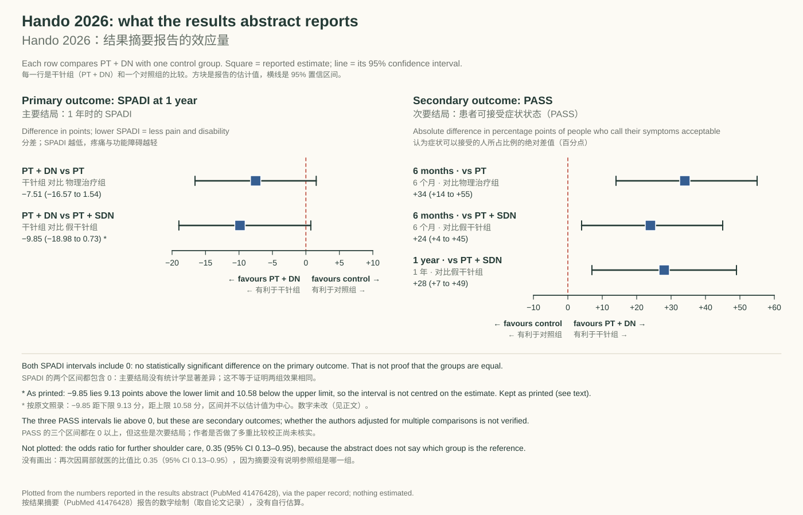
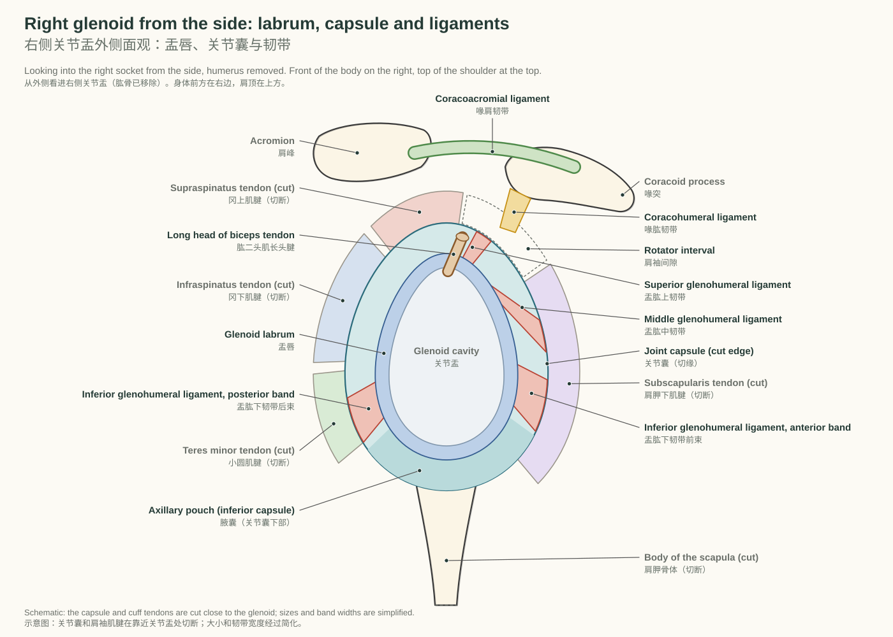
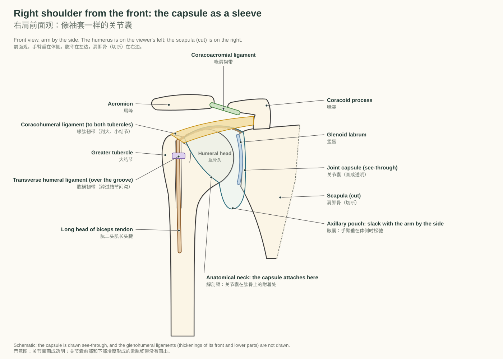
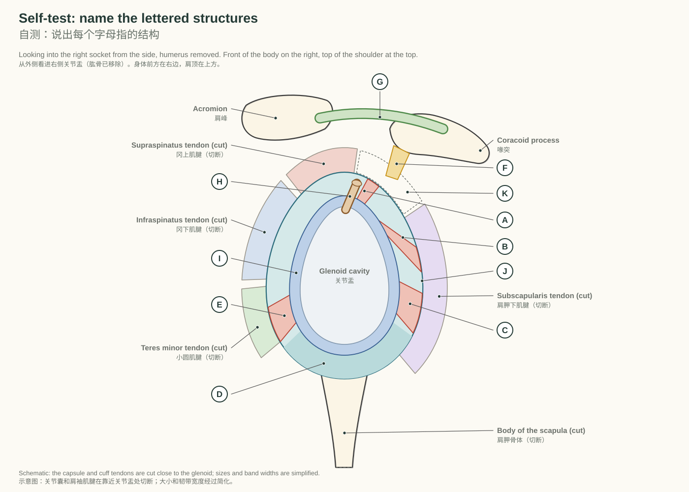

# 第 1 周 周四｜论文精读：干针治疗肩峰下疼痛 · 盂肱关节的关节囊与韧带

DPT 基础 · 2026-10-15 · Reading a dry-needling trial · the glenohumeral capsule and ligaments

## 01 New: reading a trial of dry needling for subacromial pain

新内容：精读一项干针治疗肩峰下疼痛的随机试验

> **After this chapter you can｜读完本章，你能够**
> 1. Say what each of the trial's two comparisons answers, and which outcome was primary. 说出试验的两项比较各回答什么问题，哪个结局是主要结局。
> 2. Read each effect size with its 95% confidence interval, and say why the PASS differences are percentage points and why the odds ratio cannot become a risk reduction. 结合 95% 置信区间读每个效应量；说出 PASS 差值为什么是百分点，比值比为什么不能改写成风险降低。
> 3. Keep what the protocol planned apart from what has been verified, and say how far the result applies. 把研究方案计划的方法和已经核实的执行情况分开，并说出结果能用到多远。
>
> **Key terms｜关键词：** Dry needling（干针） `DRY NEED-ling` /draɪ ˈnidlɪŋ/ · Sham（假对照（假干针）） `SHAM` /ʃæm/ · Randomization（随机化） `ran-duh-muh-ZAY-shuhn` /ˌrændəməˈzeɪʃən/ · Allocation concealment（分配隐藏） `al-uh-KAY-shuhn kuhn-SEEL-muhnt` /ˌæləˈkeɪʃən kənˈsilmənt/ · Blinding（盲法） `BLYN-ding` /ˈblaɪndɪŋ/ · Shoulder Pain and Disability Index（肩痛与功能障碍指数（SPADI）） `SHOHL-der PAYN uhnd dis-uh-BIL-uh-tee IN-deks` /ˈʃoʊldər peɪn ənd ˌdɪsəˈbɪləti ˈɪnˌdɛks/ · Patient Acceptable Symptom State（患者可接受症状状态（PASS）） `PAY-shuhnt ak-SEP-tuh-buhl SIMP-tuhm STAYT` /ˈpeɪʃənt əkˈsɛptəbəl ˈsɪmptəm steɪt/ · Confidence interval（置信区间） `KAHN-fuh-duhns IN-ter-vuhl` /ˈkɑnfədəns ˈɪntərvəl/ · Percentage point（百分点） `per-SEN-tij POYNT` /pərˈsɛntɪdʒ pɔɪnt/ · Odds ratio（比值比（优势比，OR）） `AHDZ RAY-shee-oh` /ɑdz ˈreɪʃiˌoʊ/ · Intention-to-treat（意向治疗） `in-TEN-shuhn tuh TREET` /ɪnˈtɛnʃən tə trit/ · Multiplicity（多重比较） `mul-tuh-PLIS-uh-tee` /ˌmʌltəˈplɪsəti/ · Subacromial pain syndrome（肩峰下疼痛综合征） `sub-uh-KROH-mee-uhl PAYN SIN-drohm` /ˌsʌbəˈkroʊmiəl peɪn ˈsɪnˌdroʊm/

Tuesday's pathway left a gap: the 2014 Dutch guideline gave no recommendation on dry needling for subacromial pain syndrome (Diercks 2014). Today's paper is a sham-controlled randomised trial that added dry needling to manual therapy and exercise. The reading uses this week's paper record (daily/papers): the results abstract and the published protocol, checked on 2026-10-06. The full article and the trial registry were not checked, so some questions stay open, and the text says which.

周二的流程留了一个空白：2014 年荷兰指南对肩峰下疼痛综合征的干针治疗没有给出推荐（Diercks 2014）。今天的论文是一项假干针对照的随机试验：在手法治疗和运动治疗的基础上加干针。精读依据本周的论文记录（daily/papers），也就是 2026-10-06 核对过的结果摘要和已发表的研究方案。结果论文全文和试验注册页都没有核对，所以有些问题还没有答案，正文会说明是哪些。

#### Dry Needling Plus Manual Therapy and Exercise for Subacromial Pain Syndrome: A Sham-Controlled Randomized Clinical Trial｜干针联合手法治疗与运动治疗肩峰下疼痛综合征：一项假干针对照随机临床试验

Hando BR et al. · JOSPT 2026;56(1):50–63 · [DOI 10.2519/jospt.2025.13460](https://doi.org/10.2519/jospt.2025.13460)

**Research question｜研究问题**

What additional effect does dry needling have when it is added to manual therapy and exercise for subacromial pain syndrome (SAPS)? The trial compared physical therapy (PT) alone, PT plus sham dry needling (PT + SDN), and PT plus dry needling (PT + DN). The PT comparison estimates the added effect of including dry needling in the treatment program, whereas the sham comparison also accounts for aspects of receiving a needling procedure, so the two comparisons address different questions.

在手法治疗与运动治疗的基础上加用干针，对肩峰下疼痛综合征（SAPS）有什么额外效果？试验比较了单纯物理治疗（PT）、物理治疗加假干针（PT + SDN），以及物理治疗加干针（PT + DN）。与 PT 组的比较估计在治疗方案中加入干针的额外效果；与假干针组的比较还考虑了接受针刺程序所涉及的部分因素，因此这两项比较回答的问题不同。

**Design｜设计**

A sham-controlled randomized clinical trial with three groups: PT (manual therapy and exercise), PT + SDN, and PT + DN. This appraisal is based on the results abstract and the public study protocol; the full results article has not been obtained. A protocol records planned methods and cannot establish how the trial was actually conducted. The paper identifies trial registration NCT03442894, but the current registry contents and amendment history have not been verified.

这是一项假干针对照随机临床试验，分为三组：PT（手法治疗与运动治疗）、PT + SDN 和 PT + DN。本评价依据结果摘要与公开研究方案，尚未取得结果论文全文。研究方案记录的是计划采用的方法，不能据此确认试验实际怎样执行。论文注明的试验登记号为 NCT03442894，但注册页面的当前内容与修改历史尚未核验。

**Population｜人群**

The results abstract reports 121 participants with subacromial pain syndrome (SAPS). The planned sample in the protocol was 130; this difference is not a count of participants lost to follow-up. Group-specific missingness and reasons for dropout remain unverified.

结果摘要报告 121 名肩峰下疼痛综合征（SAPS）患者。研究方案计划的样本量为 130 人；这一差额并不是失访人数。各组缺失数据的分布与退出原因仍未核实。

**Methods｜方法**

All three groups received physical therapy consisting of manual therapy and exercise; two groups additionally received sham dry needling or dry needling. The primary outcome was the Shoulder Pain and Disability Index (SPADI) at 1 year; secondary outcomes included the Patient Acceptable Symptom State (PASS) and additional shoulder-related care within 1 year. The protocol planned sequentially numbered, opaque, sealed envelopes for allocation concealment, blinding of participants receiving real or sham needling to that distinction, and analysis in the originally assigned groups. Whether these planned procedures were implemented as planned remains unverified.

三组都接受由手法治疗与运动治疗组成的物理治疗，其中两组另外加用假干针或干针。主要结局是 1 年时的肩痛与功能障碍指数（SPADI）；次要结局包括患者可接受症状状态（PASS），以及入组后 1 年内再次因肩部问题就医。研究方案计划采用顺序编号、不透明且密封的信封进行分配隐藏，使接受真干针或假干针的患者不知道自己接受的是哪一种，并按照最初随机分配的组别进行分析。这些计划程序是否按计划落实，仍未核实。

**Results｜结果**

As reported in the abstract, the 1-year SPADI difference was −7.51 (95% CI −16.57 to 1.54) for PT + DN vs PT and −9.85 (95% CI −18.98 to 0.73) for PT + DN vs PT + SDN; both intervals include zero, so the primary comparisons did not reach statistical significance. At 6 months, absolute PASS differences were +34 percentage points (95% CI +14 to +55 percentage points) for PT + DN vs PT and +24 percentage points (95% CI +4 to +45 percentage points) for PT + DN vs PT + SDN; at 1 year, +28 percentage points (95% CI +7 to +49 percentage points) for PT + DN vs PT + SDN. For additional shoulder-related care within 1 year, the reported odds ratio (OR) was 0.35 (95% CI, 0.13–0.95); the abstract does not identify the reference group. An odds ratio cannot be directly restated as a risk reduction, so this value should not be described as a 65% reduction in risk.

按摘要所载，1 年 SPADI 组间差值为：PT + DN 对比 PT −7.51（95% 置信区间 −16.57 到 1.54），PT + DN 对比 PT + SDN −9.85（95% 置信区间 −18.98 到 0.73）；两项置信区间都包含 0，因此主要比较未达到统计学显著性。6 个月时，PASS 的绝对差值为：PT + DN 对比 PT +34 个百分点（95% 置信区间 +14 至 +55 个百分点），PT + DN 对比 PT + SDN +24 个百分点（95% 置信区间 +4 至 +45 个百分点）；1 年时，PT + DN 对比 PT + SDN 为 +28 个百分点（95% 置信区间 +7 至 +49 个百分点）。对于入组后 1 年内再次因肩部问题就医，摘要报告的优势比（OR）为 0.35（95% 置信区间 0.13–0.95）；摘要未说明参照组。优势比不能直接改写为风险降低的比例，因此不能把这个数值描述为“风险降低 65%”。

**Limitations｜局限**

This appraisal rests on the results abstract and the protocol only: the full results article was not obtained, the registry was not checked, and the appraisal is not a complete risk-of-bias assessment. Adequate allocation concealment, masking success, the handling of missing data, multiplicity adjustment, and adverse-event reporting all remain unverified, and missing verification is not evidence that a method was omitted. The protocol abstract lists SPADI and PROMIS-57, whereas its statistical section specifies 1-year SPADI as the primary endpoint; this wording difference alone does not establish outcome switching. The protocol planned database and record-based health care data, whereas the results abstract describes self-report; this difference and the OR reference group remain unresolved.

本评价只依据结果摘要与研究方案：尚未取得结果论文全文，也未核验注册页面，因此并不构成完整的偏倚风险评价。分配隐藏是否充分落实、盲法是否成功、缺失数据如何处理、是否进行多重比较校正以及不良事件报告情况都仍未核实，而未能核实某项方法，不等于有证据表明研究未实施该方法。研究方案摘要列出 SPADI 和 PROMIS-57，但其统计部分将 1 年时的 SPADI 明确定为主要终点；仅凭这处措辞差异，不能认定发生了结局更换。研究方案计划通过数据库及病历收集就医数据，结果摘要则描述为患者自报；这一差异以及 OR 的参照组仍待厘清。

**Applicability｜适用范围**

In this appraisal's interpretation, the trial did not establish an additional benefit of dry needling on 1-year SPADI; this does not establish equivalence or prove that dry needling has no effect. Favorable secondary findings warrant cautious, outcome-specific interpretation and cannot replace the primary result. The results cannot be generalized to every dry-needling protocol, all shoulder pain, or acupuncture as a whole.

按本评价的解读，这项试验未能在 1 年 SPADI 上确立加用干针的额外获益；这并不等于证明各组等效，也不等于证明干针没有作用。有利的次要发现应按具体结局谨慎解释，不能用来替代主要结果。结果不能推广到所有干针方案、全部肩痛患者，或针灸整体。

- **Randomization and allocation concealment｜随机化与分配隐藏**：Randomization determines group assignment; allocation concealment prevents advance knowledge of the next assignment during enrollment. The protocol planned sequentially numbered, opaque, sealed envelopes, and whether this procedure was implemented adequately remains unverified. 随机化用于确定分组；分配隐藏用于防止在入组过程中提前知道下一次分配结果。研究方案计划采用顺序编号、不透明且密封的信封，该程序是否得到充分落实，仍未核实。
- **Sham comparator｜假干针对照**：The comparison with PT alone estimates the added effect of including dry needling in the treatment program. The comparison with sham dry needling also accounts for aspects of receiving a needling procedure, so the two comparisons address different questions. 与单纯 PT 组的比较估计在治疗方案中加入干针的额外效果；与假干针组的比较还考虑了接受针刺程序所涉及的部分因素，因此这两项比较回答的问题不同。
- **Blinding｜盲法**：The protocol planned to blind participants receiving real or sham needling to that distinction. Participants in the no-needling group would know their assignment, and treating clinicians could not be blinded to the treatment delivered. Actual masking success and unmasking require the results report. 研究方案计划使接受真干针或假干针的患者不知道自己接受的是哪一种。未接受针刺的患者会知道自己的分组，实施治疗的临床人员也无法对所提供的治疗设盲。盲法实际是否成功以及是否发生揭盲，需要结果论文才能核实。
- **Shoulder Pain and Disability Index (SPADI)｜肩痛与功能障碍指数（SPADI）**：Lower SPADI scores indicate less pain and disability. In this trial, a negative between-group difference favors PT + DN. SPADI 分数越低，表示疼痛与功能障碍越轻。在本试验中，组间差值为负数时，方向上有利于 PT + DN 组。
- **Patient Acceptable Symptom State (PASS)｜患者可接受症状状态（PASS）**：PASS records whether participants consider their current symptoms acceptable. The reported differences are absolute percentage-point differences in affirmative responses, not relative percentage improvements. PASS 记录患者是否认为目前的症状可以接受。报告的差值是回答“可以接受”的比例之绝对差值，单位为百分点，并非相对改善百分比。
- **95% confidence interval (CI)｜95% 置信区间**：Both 1-year SPADI confidence intervals include zero, so the primary comparisons did not reach statistical significance. This does not establish equivalence or prove that dry needling has no effect. 两项 1 年 SPADI 置信区间都包含 0，因此主要比较未达到统计学显著性。这并不等于证明各组等效，也不等于证明干针没有作用。
- **Odds ratio (OR)｜优势比（OR）**：An odds ratio cannot be directly restated as a risk reduction, so the reported OR of 0.35 should not be described as a 65% reduction in risk. The abstract does not identify the reference group. 优势比不能直接改写为风险降低的比例，因此不能把报告的 OR 0.35 描述为“风险降低 65%”。摘要未说明参照组。
- **Multiplicity adjustment｜多重比较校正**：Multiplicity adjustment and adverse-event reporting have not been verified. Favorable secondary results therefore need separate appraisal rather than replacing the primary result. 多重比较校正与不良事件报告尚未核实。因此，有利的次要结果需要单独评价，不能用来替代主要结果。
- **Intention-to-treat principle｜意向治疗原则**：The protocol planned analysis in the originally assigned groups. An intention-to-treat principle does not, by itself, solve missing-data bias; evaluating the estimates requires the actual analysis population, missing-data assumptions, and sensitivity analyses. 研究方案计划按照最初随机分配的组别进行分析。意向治疗原则本身并不能解决缺失数据带来的偏倚；评价效应估计，还需要了解实际分析人群、缺失数据假设与敏感性分析。
- **Sample size and attrition｜样本量与失访**：The planned sample was 130, and the results abstract reports 121 participants. This difference is not a count of participants lost to follow-up. 计划样本量为 130 人，结果摘要报告 121 名参与者。这一差额并不是失访人数。
- **Prespecified outcomes and selective reporting｜预设结局与选择性报告**：A wording difference between parts of a protocol does not, by itself, establish outcome switching. The dated protocol, registration history, and final report must be compared. 研究方案不同部分之间的措辞差异，本身不能认定发生了结局更换。仍需对照注明日期的研究方案、注册历史和最终报告。
- **Study protocol｜研究方案**：A protocol records planned methods and cannot establish how the trial was actually conducted. Missing verification is not evidence that a method was omitted. 研究方案记录的是计划采用的方法，不能据此确认试验实际怎样执行。未能核实某项方法，不等于有证据表明研究未实施该方法。

### Read it in order: eight steps｜按顺序读：八步

Go through the card above in this order. The middle column is what the record reports; the right column is what the abstract and protocol cannot settle.

按这个顺序把上面的卡片过一遍。中间一列是记录里报告的内容；右边一列是摘要和研究方案解决不了的问题。

| Step 步骤 | What the record says 论文记录里的内容 | Still open at this level 在这一层还没解决的 |
|---|---|---|
| 1 Question and design 1 研究问题与设计 | Does dry needling add anything to manual therapy and exercise for subacromial pain syndrome? A randomised, sham-controlled trial with three groups. 在手法治疗和运动治疗之外加干针，对肩峰下疼痛综合征有没有额外效果？这是一项随机、假干针对照的三组试验。 | Registration NCT03442894: the current registry page and its amendment history were not checked. 试验登记号 NCT03442894：注册页面的当前内容和修改历史没有核对。 |
| 2 Population 2 人群 | 121 participants with subacromial pain syndrome; the protocol planned 130. 121 名肩峰下疼痛综合征患者；研究方案计划 130 人。 | The gap of 9 is not a count of people lost to follow-up. Missing data by group and reasons for dropout are not known. 相差的 9 人不是失访人数。各组缺失多少数据、为什么退出，都不清楚。 |
| 3 Groups compared 3 比较的组 | PT (manual therapy and exercise); PT + sham dry needling (PT + SDN); PT + dry needling (PT + DN). Against PT, the trial estimates the added effect of including needling in the programme; against sham, it also accounts for aspects of receiving a needling procedure. PT（手法治疗与运动治疗）；PT + 假干针（PT + SDN）；PT + 干针（PT + DN）。与 PT 比，估计的是在方案里加上干针的额外效果；与假干针比，还考虑了接受针刺程序本身的部分因素。 | Where, how deep and how often the needling was done is not in the record; it is not filled in here from second-hand summaries. 扎在哪里、扎多深、扎几次，记录里没有；这里也不拿二手概括来补。 |
| 4 Primary and secondary outcomes 4 主要与次要结局 | Primary: the Shoulder Pain and Disability Index (SPADI) at 1 year. Secondary outcomes include the Patient Acceptable Symptom State (PASS) and further shoulder-related care within 1 year. 主要结局：1 年时的肩痛与功能障碍指数（SPADI）。次要结局包括患者可接受症状状态（PASS），以及 1 年内再次因肩部问题就医。 | The protocol abstract lists SPADI and PROMIS-57, while its statistics section names 1-year SPADI as primary. That wording alone does not show the outcome was switched. 研究方案摘要列出 SPADI 和 PROMIS-57，统计部分则把 1 年 SPADI 定为主要终点。仅凭这处措辞，不能认定换了结局。 |
| 5 Effect size and 95% CI 5 效应量与 95% 置信区间 | SPADI at 1 year: −7.51 (95% CI −16.57 to 1.54) against PT; −9.85 (95% CI −18.98 to 0.73) against sham. Both intervals include 0. PASS: three differences, all above 0 (figure 01). 1 年 SPADI：对比 PT 为 −7.51（95% CI −16.57 到 1.54）；对比假干针为 −9.85（95% CI −18.98 到 0.73）。两个区间都包含 0。PASS：三项差值都在 0 以上（图 01）。 | The second SPADI interval is not centred on its estimate (see below). The odds ratio's reference group is not stated. 第二个 SPADI 区间不以估计值为中心（见下文）。比值比的参照组没有说明。 |
| 6 Bias 6 偏倚 | The protocol planned sequentially numbered, opaque, sealed envelopes; blinding of participants to real versus sham needling; and analysis in the groups as randomised. 研究方案计划：顺序编号、不透明的密封信封；让接受真、假干针的患者不知道自己是哪一种；按最初随机分配的组分析。 | Whether these were carried out as planned, whether blinding worked, how missing data were handled, any adjustment for multiple comparisons, and adverse events: none verified. The no-needling group and the treating clinicians could not be blinded. 这些是否按计划落实、盲法是否成功、缺失数据怎么处理、有没有做多重比较校正、不良事件：都没有核实。不扎针那组的患者和实施治疗的人员本来就无法设盲。 |
| 7 Applicability 7 适用范围 | Our reading: the results apply to people with subacromial pain syndrome who also receive manual therapy and exercise. 我们的解读：结果适用于同时接受手法治疗和运动治疗的肩峰下疼痛综合征患者。 | It does not extend to every dry-needling protocol, to all shoulder pain, or to acupuncture as a whole. 不能推广到所有干针方案、全部肩痛，或针灸整体。 |
| 8 Where the conclusion stops 8 结论的边界 | Our reading (the record's appraisal, not the authors' conclusion): the trial did not establish an added benefit on 1-year SPADI; the favourable secondary results need cautious reading, one outcome at a time. 我们的解读（论文记录的评价，不是作者的结论）：这项试验没有在 1 年 SPADI 上确立加用干针的额外获益；有利的次要结果要逐项谨慎解读。 | This is not proof that the groups are equivalent, and not proof that dry needling has no effect. 这既不证明各组等效，也不证明干针没有作用。 |

*The effect sizes the results abstract reports. Left: the primary outcome, SPADI at 1 year; both intervals include 0. Right: PASS in percentage points; all three intervals lie above 0. The odds ratio is left out because its reference group is not stated.*  
*结果摘要报告的效应量。左：主要结局，1 年 SPADI，两个区间都包含 0。右：PASS，单位是百分点，三个区间都在 0 以上。比值比没有画，因为参照组没有说明。*

### Three numbers that are easy to misread｜三个容易读错的数字

−7.51 (−16.57 to 1.54). The interval includes 0, so the trial did not show a statistically significant difference on SPADI. But the same interval also includes differences that favour dry needling by more than 16 points. “Not shown” is not “shown to be equal”.

−7.51（−16.57 到 1.54）。区间包含 0，所以试验没有在 SPADI 上显示出统计学显著的差异。但同一个区间里也有对干针有利、超过 16 分的差值。“没有显示出差异”不等于“显示两组相同”。

+34 percentage points. PASS asks whether people find their current symptoms acceptable. +34 is an absolute difference in the share who said yes. An illustration with made-up group figures, which are not in the record: if 40% of the PT group said yes, about 74% of the PT + DN group did. It is not “34% better”.

+34 个百分点。PASS 问的是患者觉得目前的症状能不能接受。+34 是回答“能接受”的比例之差，是绝对差值。举个例子（各组比例是虚构的，记录里没有）：如果 PT 组有 40% 的人说能接受，PT + DN 组大约就是 74%。它不是“好了 34%”。

Odds ratio 0.35 (0.13–0.95). An odds ratio compares odds, not risks, so it cannot be rewritten as “65% less further care”. The abstract also does not say which group is the reference, so it is not clear which comparison the number describes.

比值比 0.35（0.13–0.95）。比值比比较的是比值（odds），不是风险，所以不能改写成“再就医减少 65%”。摘要也没有说明参照组是哪一组，所以这个数字描述的是哪一项比较并不清楚。

**易混点：** “区间包含 0”只说明没有显示出差异；“区间都在 0 以上”的次要结局也不能替代主要结局。读论文先看主要结局，再看次要结局，并留意作者有没有做多重比较校正：这项试验在摘要和研究方案这一层还看不到。

### A check on the printed numbers (our reading)｜核对一下印出来的数字（我们的解读）

This is our own arithmetic, not a statement in the paper. The first SPADI interval is centred on its estimate: −7.51 lies 9.06 points above −16.57 and 9.05 below 1.54. The second is not: −9.85 lies 9.13 points above −18.98 but 10.58 below 0.73. A symmetric interval with the same lower limit would end near −0.72 and would not include 0. Some analyses do produce asymmetric intervals, so this does not prove an error; only the full article can settle it. The record keeps the number as printed, and so does this pack, so the reading “both intervals include 0” stands.

下面是我们自己的计算，不是论文里的说法。第一个 SPADI 区间以估计值为中心：−7.51 比 −16.57 高 9.06 分，比 1.54 低 9.05 分。第二个不是：−9.85 比 −18.98 高 9.13 分，却比 0.73 低 10.58 分。如果下限不变、区间对称，上限应在 −0.72 左右，那样就不包含 0 了。有些分析方法确实会给出不对称的区间，所以这不能证明印错了，只有全文能回答。论文记录按原数照录，本包也一样，因此“两个区间都包含 0”这个解读不变。

If a patient asks about dry needling, one way to put it (our wording, not the authors'): “In one randomised trial with a sham group, adding dry needling to exercise and manual therapy made no clear difference to pain and function at one year. One other measure, whether people found their symptoms acceptable, looked better with needling, but that needs confirming.”

如果病人问起干针，可以这样说（这是我们的说法，不是作者的原话）：“有一项设了假干针对照的随机试验，在运动和手法治疗之外加干针，一年后的疼痛和功能没有明确的差别。有一项其他指标，也就是患者是否觉得目前的症状可以接受，在加干针的组看起来更好，但还需要验证。”

#### Check yourself｜先自测

**Q.** The trial has two control groups. What does the comparison with PT answer, and what does the comparison with sham add? 试验有两个对照组。与 PT 组比较回答什么问题？与假干针组比较又多考虑了什么？

Answer 答案

Against PT: the added effect of including dry needling in the programme. Against sham: it also accounts for aspects of receiving a needling procedure. The two comparisons answer different questions. 与 PT 比：在方案里加上干针的额外效果。与假干针比：还考虑了接受针刺程序本身的部分因素。两项比较回答的问题不同。

**Q.** The 1-year SPADI difference against PT is −7.51 (95% CI −16.57 to 1.54). Does this show that dry needling does not work? 1 年 SPADI 与 PT 组相比的差值是 −7.51（95% CI −16.57 到 1.54）。这能说明干针没用吗？

Answer 答案

No. The interval includes 0, so no statistically significant difference was shown, and it also includes differences that favour dry needling. It neither establishes equivalence nor proves no effect. 不能。区间包含 0，只说明没有显示出统计学显著差异；区间里也有对干针有利的差值。这既不证明等效，也不证明没有作用。

**Q.** At 6 months, PASS was +34 percentage points for PT + DN against PT. What does +34 mean? 6 个月时，PT + DN 对比 PT 的 PASS 是 +34 个百分点。+34 是什么意思？

Answer 答案

The share of people who called their symptoms acceptable was 34 percentage points higher with PT + DN (95% CI +14 to +55). It is an absolute difference in proportions, not a 34% relative improvement. PT + DN 组认为症状能接受的人所占比例高 34 个百分点（95% CI +14 到 +55）。这是比例的绝对差值，不是相对改善 34%。

**Q.** Why must the odds ratio of 0.35 for further shoulder care not be reported as “65% less care”? 为什么再次因肩部就医的比值比 0.35 不能写成“就医减少 65%”？

Answer 答案

An odds ratio compares odds, not risks, so it cannot be restated as a risk reduction; and the abstract does not say which group is the reference. 比值比比较的是比值，不是风险，不能改写成风险降低；而且摘要没有说明参照组。

**Q.** The protocol planned 130 participants and the abstract reports 121. Were 9 people lost to follow-up? 研究方案计划 130 人，摘要报告 121 人。是不是有 9 人失访？

Answer 答案

Not necessarily. The gap between planned and reported numbers is not a dropout count; missing data by group need the full article. 不一定。计划人数和报告人数之差不是失访人数；各组缺失数据要看全文。

**Q.** Name three methods that cannot be verified from the abstract and protocol alone. 说出三项只凭摘要和研究方案无法核实的方法。

Answer 答案

Any three of: whether allocation concealment was carried out as planned; whether blinding worked; how missing data were handled; adjustment for multiple comparisons; adverse events; the registry history; the reference group of the odds ratio. 任选三项：分配隐藏是否按计划落实；盲法是否成功；缺失数据怎么处理；多重比较校正；不良事件；注册修改历史；比值比的参照组。

> **Take-home 本章要点：** Read a trial in order and stop where the evidence stops. This one did not establish an added benefit of dry needling on its primary outcome at 1 year; its favourable secondary results need confirming; and several methods stay unverified until the full article is read.  
> 按顺序读试验，证据到哪里就停在哪里。这项试验没有在 1 年的主要结局上确立加用干针的额外获益；有利的次要结果还需要验证；好几项方法要读到全文才能核实。

## 02 Consolidate: the glenohumeral joint capsule and ligaments

夯实：盂肱关节的关节囊与韧带

> **After this chapter you can｜读完本章，你能够**
> 1. Give the joint type, where the capsule attaches, and its two weak spots. 说出关节类型、关节囊的附着处和两个薄弱处。
> 2. Give each ligament's attachments and what it limits, and point to it on a drawing. 说出每条韧带的起止和限制的运动，并能在图上指出来。
> 3. Name the plane and axis of each movement, the close-packed and loose-packed positions, and the capsular pattern. 说出每个运动的平面和轴、紧张位和松弛位，以及关节囊模式。
>
> **Key terms｜关键词：** Glenohumeral joint（盂肱关节） `glen-oh-HYOO-muh-ruhl JOYNT` /ˌɡlɛnoʊˈhjumərəl dʒɔɪnt/ · Glenoid labrum（盂唇） `GLEN-oyd LAY-bruhm` /ˈɡlɛˌnɔɪd ˈleɪbrəm/ · Joint capsule（关节囊） `JOYNT KAP-suhl` /dʒɔɪnt ˈkæpsəl/ · Anatomical neck（解剖颈） `an-uh-TAH-mih-kuhl NEK` /ˌænəˈtɑmɪkəl nɛk/ · Superior glenohumeral ligament（盂肱上韧带） `suh-PEER-ee-er glen-oh-HYOO-muh-ruhl LIG-uh-muhnt` /səˈpɪriər ˌɡlɛnoʊˈhjumərəl ˈlɪɡəmənt/ · Middle glenohumeral ligament（盂肱中韧带） `MID-uhl glen-oh-HYOO-muh-ruhl LIG-uh-muhnt` /ˈmɪdəl ˌɡlɛnoʊˈhjumərəl ˈlɪɡəmənt/ · Inferior glenohumeral ligament（盂肱下韧带） `in-FEER-ee-er glen-oh-HYOO-muh-ruhl LIG-uh-muhnt` /ɪnˈfɪriər ˌɡlɛnoʊˈhjumərəl ˈlɪɡəmənt/ · Axillary pouch（腋囊） `AK-suh-lair-ee POWCH` /ˈæksəˌlɛri paʊtʃ/ · Coracohumeral ligament（喙肱韧带） `kor-uh-koh-HYOO-muh-ruhl LIG-uh-muhnt` /ˌkɔrəkoʊˈhjumərəl ˈlɪɡəmənt/ · Transverse humeral ligament（肱横韧带） `trans-VURS HYOO-muh-ruhl LIG-uh-muhnt` /trænsˈvɝs ˈhjumərəl ˈlɪɡəmənt/ · Coracoacromial ligament（喙肩韧带） `kor-uh-koh-uh-KROH-mee-uhl LIG-uh-muhnt` /ˌkɔrəkoʊəˈkroʊmiəl ˈlɪɡəmənt/ · Rotator interval（肩袖间隙） `ROH-tay-ter IN-ter-vuhl` /ˈroʊˌteɪtər ˈɪntərvəl/ · Close-packed position（紧张位） `KLOHS-pakt puh-ZISH-uhn` /ˈkloʊs ˌpækt pəˈzɪʃən/ · Loose-packed position（松弛位） `LOOS-pakt puh-ZISH-uhn` /ˈlus ˌpækt pəˈzɪʃən/ · Capsular pattern（关节囊模式） `KAP-suh-ler PAT-ern` /ˈkæpsələr ˈpætərn/

This week's chapter covers the glenoid cavity and the cuff muscles that hold the [humeral head](http://127.0.0.1:5178/?term=humeral-head) in it, but it has no section on the capsule or its ligaments. The facts below come from the chapter's own shoulder-joint sources, TeachMeAnatomy and Kenhub, checked against Radiopaedia and StatPearls; where they differ, the tables and the list after them say so. Read the tables and figures 02 and 04 first. Then scroll them out of sight and do the self-test with figure 03.

本周章节讲了关节盂和把肱骨头稳在里面的肩袖，但没有讲关节囊和韧带。下面的内容取自章节自己列的肩关节来源 TeachMeAnatomy 和 Kenhub，并用 Radiopaedia 和 StatPearls 核对过；来源不一致的地方，表格和表后的列表会写明。先看表格和图 02、04，然后把它们滑出屏幕，再对着图 03 做自测。

### The joint｜关节本身

| Feature 项目 | What the sources say 来源怎么说 | Source 来源 |
|---|---|---|
| Type 类型 | A synovial ball-and-socket joint; multiaxial, with three degrees of freedom. 滑膜关节中的球窝关节；多轴，有三个自由度。 | Kenhub; TeachMeAnatomy Kenhub；TeachMeAnatomy |
| Joint surfaces 关节面 | The [humeral head](http://127.0.0.1:5178/?term=humeral-head) has 3–4 times the surface area of the glenoid cavity. The chapter calls the glenoid a shallow socket in which the rotator cuff helps hold the head. 肱骨头的面积是关节盂的 3–4 倍。章节把关节盂称为浅窝，肩袖帮助把肱骨头稳定在里面。 | Kenhub; chapter Kenhub；本周章节 |
| Glenoid labrum 盂唇 | A fibrocartilage rim around the glenoid cavity; triangular in cross-section and thicker in front than below; continuous with the long head of biceps at the top. 围绕关节盂的纤维软骨环；横断面呈三角形，前部比下部厚；上方与肱二头肌长头相延续。 | TeachMeAnatomy; Kenhub; StatPearls TeachMeAnatomy；Kenhub；StatPearls |
| Joint capsule 关节囊 | Runs from the anatomical neck of the [humerus](http://127.0.0.1:5178/?term=humerus) to the glenoid. In front and below it inserts into the scapular neck, behind the labrum; above and behind it blends with the labrum. It is lax and lined by synovial membrane. 从肱骨解剖颈到关节盂。前方和下方止于盂唇后方的肩胛颈；上方和后方直接与盂唇融合。关节囊松弛，内衬滑膜。 | Kenhub; TeachMeAnatomy Kenhub；TeachMeAnatomy |
| Openings in the capsule 关节囊的开口 | One between the tubercles, where the long head of biceps tendon leaves the joint; one where the joint communicates with the subscapular bursa. 一处在大、小结节之间，肱二头肌长头腱从这里出关节；一处与肩胛下肌腱下囊相通。 | Kenhub |
| Weak spots 薄弱处 | The rotator interval, the gap between the [subscapularis](http://127.0.0.1:5178/?term=subscapularis) and [supraspinatus](http://127.0.0.1:5178/?term=supraspinatus) tendons where no cuff tendon covers the capsule (its roof is reinforced by the CHL, and the SGHL also supports it); and the inferior capsule, the weakest part, stretched in abduction and folded with the arm by the side. 肩袖间隙：位于肩胛下肌腱和冈上肌腱之间，这里的关节囊没有肩袖肌腱覆盖（顶由喙肱韧带加强，盂肱上韧带也起支持作用）；以及关节囊下部：最薄弱，外展时被拉紧，手臂垂在体侧时形成皱襞。 | Kenhub; Radiopaedia Kenhub；Radiopaedia |
| Stabilisers 稳定结构 | Static: labrum, capsule and ligaments. Dynamic: muscles, including the rotator cuff, whose tone presses the head into the glenoid. 静态：盂唇、关节囊和韧带。动态：肌肉，包括肩袖；肩袖的张力把肱骨头压向关节盂。 | StatPearls; TeachMeAnatomy StatPearls；TeachMeAnatomy |

### Ligaments｜韧带

| Ligament 韧带 | From → to 起 → 止 | What it does or limits 作用或限制 | Source 来源 |
|---|---|---|---|
| Superior glenohumeral (SGHL) 盂肱上韧带 | Supraglenoid tubercle → upper [lesser tubercle](http://127.0.0.1:5178/?term=lesser-tubercle). Radiopaedia also gives the coracoid as an origin. 盂上结节 → 小结节上部。Radiopaedia 另把喙突列为起点之一。 | Resists inferior translation, especially with the arm adducted; steadies the long head of biceps tendon. 对抗肱骨头向下移位，尤其在内收位；稳定肱二头肌长头腱。 | Kenhub; Radiopaedia Kenhub；Radiopaedia |
| Middle glenohumeral (MGHL) 盂肱中韧带 | Anterior glenoid, just below the SGHL → [lesser tubercle](http://127.0.0.1:5178/?term=lesser-tubercle). 关节盂前缘、盂肱上韧带下方 → 小结节。 | Limits external rotation, especially with the arm abducted. Absent in about 30% of shoulders. 限制外旋，尤其在外展位。约 30% 的肩关节没有这条韧带。 | Kenhub; Radiopaedia Kenhub；Radiopaedia |
| Inferior glenohumeral (IGHL) 盂肱下韧带 | A sling from the inferior two-thirds of the labrum → inferior anatomical neck; an anterior band and a posterior band, with the axillary pouch between them. 像吊床一样，从盂唇下 2/3 → 解剖颈下部；分前束和后束，两束之间是腋囊。 | The strongest of the three and the main stabiliser of the abducted shoulder. Both bands steady the joint above 90° of abduction; the anterior band limits external rotation, the posterior band internal rotation. 三条中最强，是外展位肩关节的主要稳定结构。外展超过 90° 时两束都起稳定作用；前束限制外旋，后束限制内旋。 | Kenhub; Radiopaedia Kenhub；Radiopaedia |
| Coracohumeral (CHL) 喙肱韧带 | Lateral base of the coracoid → greater and lesser tubercles (TeachMeAnatomy names only the [greater tubercle](http://127.0.0.1:5178/?term=greater-tubercle)). It reinforces the roof of the rotator interval and covers the long head of biceps tendon (Radiopaedia). 喙突根部外侧 → 大、小结节（TeachMeAnatomy 只写大结节）。它加强肩袖间隙的顶，并覆盖肱二头肌长头腱（Radiopaedia）。 | Supports the superior capsule; limits inferior translation and excessive external rotation. With the arm in external rotation, only the CHL contributed significantly to inferior stability (Itoi 1998). 加强关节囊上部；限制肱骨头向下移位和过度外旋。手臂外旋时，只有喙肱韧带对防止向下移位有显著作用（Itoi 1998）。 | Kenhub; Radiopaedia; StatPearls; Itoi 1998 Kenhub；Radiopaedia；StatPearls；Itoi 1998 |
| Transverse humeral (THL) 肱横韧带 | Across the [intertubercular groove](http://127.0.0.1:5178/?term=intertubercular-groove), from the greater to the [lesser tubercle](http://127.0.0.1:5178/?term=lesser-tubercle). 横跨结节间沟，从大结节到小结节。 | Holds the long head of biceps tendon in the groove. StatPearls notes it may not be a distinct structure. 把肱二头肌长头腱固定在沟内。StatPearls 指出它可能不是一条独立的结构。 | TeachMeAnatomy; StatPearls TeachMeAnatomy；StatPearls |
| Coracoacromial (CAL) 喙肩韧带 | Coracoid process → [acromion](http://127.0.0.1:5178/?term=acromion). Both ends are on the [scapula](http://127.0.0.1:5178/?term=scapula), so it does not cross the joint. 喙突 → 肩峰。两端都在肩胛骨上，所以不跨过关节。 | Forms the middle of the coracoacromial arch over the head and resists upward displacement of the head. A thickened ligament can contribute to impingement. 构成肱骨头上方喙肩弓的中段，对抗肱骨头向上移位。韧带增厚可能参与撞击。 | Radiopaedia; TeachMeAnatomy Radiopaedia；TeachMeAnatomy |
| Rotator interval (a space, not a ligament) 肩袖间隙（是间隙，不是韧带） | A triangle between the [supraspinatus](http://127.0.0.1:5178/?term=supraspinatus) and [subscapularis](http://127.0.0.1:5178/?term=subscapularis) tendons, with the base of the coracoid at its base. 冈上肌腱和肩胛下肌腱之间的三角区，底边在喙突根部。 | Its roof is capsule reinforced by the CHL; it contains the long head of biceps tendon and the SGHL, which with the CHL keep the tendon from slipping out. 顶是由喙肱韧带加强的关节囊；里面有肱二头肌长头腱和盂肱上韧带；盂肱上韧带与喙肱韧带一起防止长头腱滑脱。 | Radiopaedia; Kenhub Radiopaedia；Kenhub |

*The right glenoid seen from the side with the [humerus](http://127.0.0.1:5178/?term=humerus) removed. The capsule is a sleeve cut close to the bone; the three glenohumeral ligaments are thickenings in its front and lower parts. The cuff tendons lie outside the capsule; none of them covers the inferior capsule, and the rotator interval is the gap between [supraspinatus](http://127.0.0.1:5178/?term=supraspinatus) and [subscapularis](http://127.0.0.1:5178/?term=subscapularis).*  
*移除肱骨后从外侧看右侧关节盂。关节囊像一个袖套，在靠近骨处切断；三条盂肱韧带是关节囊前部和下部的增厚。肩袖肌腱在关节囊外面，没有一条覆盖关节囊下部；肩袖间隙就是冈上肌和肩胛下肌之间的空隙。*

*The same joint from the front, arm by the side. The capsule runs from the glenoid margin to the anatomical neck and hangs below as the axillary pouch. The long head of biceps tendon crosses the top of the head inside the joint and leaves it through the groove, under the transverse humeral ligament.*  
*同一个关节的前面观，手臂垂在体侧。关节囊从关节盂边缘延伸到解剖颈，下方垂成腋囊。肱二头肌长头腱在关节内越过肱骨头顶部，经结节间沟、在肱横韧带下面离开关节。*

### Planes, axes and positions｜平面、轴和体位

| Movement 运动 | Plane 平面 | Axis 轴 | Kenhub: glenohumeral joint alone (active) Kenhub：仅盂肱关节（主动） | Kenhub: whole shoulder complex Kenhub：整个肩复合体 | StatPearls: listed under glenohumeral joint motion StatPearls：列在“盂肱关节运动”下 |
|---|---|---|---|---|---|
| Flexion / extension 屈 / 伸 | Sagittal 矢状面 | Frontal-horizontal (side to side) 额状水平轴（左右方向） | 110° / 60° | 180° / 90° | 180° / 45–60° |
| Abduction / adduction 外展 / 内收 | Frontal (coronal) 额状面（冠状面） | Sagittal-horizontal (front to back) 矢状水平轴（前后方向） | 120° / 0° | 180° / 30° | 150° abduction 外展 150° |
| Internal / external rotation 内旋 / 外旋 | Horizontal (transverse), arm by the side 水平面（横断面），手臂垂在体侧时 | Vertical (longitudinal) 垂直轴（纵轴） | 90° / 90° | 90° / 90° | 70–90° / 90° |

Plane and axis pairs: Koldenhoven and Behnke, Kinetic Anatomy (publisher's excerpt). Rotation about a vertical axis: StatPearls. “With the arm by the side” is our addition: the [humerus](http://127.0.0.1:5178/?term=humerus) turns about its own long axis, which is vertical only when the arm hangs down.

平面与轴的对应：Koldenhoven 与 Behnke《Kinetic Anatomy》（出版社摘录）。绕垂直轴旋转：StatPearls。“手臂垂在体侧时”这个条件是我们加的：肱骨绕自身长轴旋转，只有手臂下垂时这条轴才是垂直的。

| Position 位置 | What the sources say 来源怎么说 | Source 来源 |
|---|---|---|
| Close-packed 紧张位（闭合位） | Abduction with external rotation: the capsule and ligaments are tightest and the surfaces fit best. 外展加外旋：关节囊和韧带最紧，关节面贴合最好。 | Kenhub |
| Loose-packed (open-packed, resting) 松弛位（开放位、休息位） | About 40–50° of abduction with about 30° of horizontal adduction. Lin 2007 measured 15 healthy people: the mean was 49.8° of glenohumeral abduction by one method and 23.7° by another; the abstract calls 30–60° the already accepted range. 外展约 40–50°，加水平内收约 30°。Lin 2007 测了 15 名健康人：一种方法测得的平均值是盂肱外展 49.8°，另一种是 23.7°；摘要把 30–60° 称为已被接受的范围。 | Kenhub; Lin 2007 Kenhub；Lin 2007 |
| Capsular pattern 关节囊模式 | External rotation is most limited, then abduction, then internal rotation, then flexion. In Tuesday's pathway, frozen shoulder showed a disproportionate loss of passive external rotation. 外旋受限最多，其次外展，再次内旋，然后屈。周二的流程里，冻结肩的表现正是被动外旋受限明显重于其他方向。 | Kenhub; Tuesday's pack Kenhub；周二的包 |

### Where the sources differ｜来源不一致的地方

- Coracohumeral ligament insertion: the [greater tubercle](http://127.0.0.1:5178/?term=greater-tubercle) (TeachMeAnatomy) or both tubercles (Kenhub, StatPearls, Radiopaedia). 喙肱韧带的止点：大结节（TeachMeAnatomy），或大、小结节（Kenhub、StatPearls、Radiopaedia）。
- Superior glenohumeral ligament origin: the supraglenoid tubercle (Kenhub); Radiopaedia adds the coracoid. Radiopaedia also says it is present in 97% of shoulders and the middle ligament is absent in about 30%. 盂肱上韧带的起点：盂上结节（Kenhub）；Radiopaedia 另加喙突。Radiopaedia 还写到盂肱上韧带见于 97% 的肩关节，盂肱中韧带约 30% 缺如。
- Transverse humeral ligament: TeachMeAnatomy describes it as holding the biceps tendon; StatPearls says it may not be a distinct structure. 肱横韧带：TeachMeAnatomy 写它固定肱二头肌腱；StatPearls 说它可能不是一条独立的结构。
- Ranges of motion: Kenhub gives two sets. For the glenohumeral joint alone (active): flexion 110°, extension 60°, abduction 120°. For the whole shoulder complex: flexion 180°, extension 90°, abduction 180°, adduction 30°. StatPearls lists flexion 180°, extension 45–60° and abduction 150° under glenohumeral joint motion without separating out scapular motion, so its flexion matches Kenhub's whole-complex figure while abduction still differs (150° against 180°). The chapter's figure 12 splits 180° of elevation into about 120° at the glenohumeral joint and 60° at the [scapula](http://127.0.0.1:5178/?term=scapula), as a teaching approximation. 活动范围：Kenhub 给了两组数字。仅盂肱关节（主动）：屈 110°、伸 60°、外展 120°。整个肩复合体：屈 180°、伸 90°、外展 180°、内收 30°。StatPearls 把屈 180°、伸 45–60°、外展 150° 列在“盂肱关节运动”下，没有把肩胛骨的活动分开；所以它的屈与 Kenhub 的肩复合体数字一致，外展仍有差别（150° 对 180°）。章节图 12 把 180° 上举分成盂肱关节约 120°、肩胛骨约 60°，这是教学上的概括。
- Resting position: Kenhub gives 40–50° of abduction with 30° of horizontal adduction; Lin 2007 measured a mean of 49.8° or 23.7° of abduction depending on the method. 休息位：Kenhub 写外展 40–50° 加水平内收 30°；Lin 2007 按测量方法不同，得到的平均外展角是 49.8° 或 23.7°。
- Rotator interval: Radiopaedia puts the lateral margin of the coracoid base at its medial side, roofs it with capsule reinforced by the CHL, and lists the long head of biceps tendon and the SGHL as its contents. StatPearls borders it with the [supraspinatus](http://127.0.0.1:5178/?term=supraspinatus) tendon above, the [subscapularis](http://127.0.0.1:5178/?term=subscapularis) tendon below, the CHL laterally and the SGHL medially, and lists the long head of biceps tendon, the CHL and the SGHL as its contents. The tables and the self-test follow Radiopaedia. 肩袖间隙：Radiopaedia 以喙突根部外侧缘为内侧界，顶是由喙肱韧带加强的关节囊，内容为肱二头肌长头腱和盂肱上韧带。StatPearls 以冈上肌腱为上界、肩胛下肌腱为下界、喙肱韧带为外侧界、盂肱上韧带为内侧界，内容为肱二头肌长头腱、喙肱韧带和盂肱上韧带。表格和自测题按 Radiopaedia 的说法。

Why this matters clinically: most dislocations are anterior, usually from excessive extension and lateral rotation, and a torn capsule raises the risk of dislocating again (TeachMeAnatomy). The chapter adds that an anterior dislocation can involve the axillary nerve and [subscapularis](http://127.0.0.1:5178/?term=subscapularis). In adhesive capsulitis the capsule becomes inflamed and stiff (StatPearls), which fits the capsular pattern above.

临床意义：大多数脱位是前脱位，通常由过度伸展和外旋引起；关节囊撕裂后，再次脱位的风险更高（TeachMeAnatomy）。本周章节还写到，前脱位可累及腋神经和肩胛下肌。粘连性关节囊炎时关节囊发炎、变僵硬（StatPearls），这和上面的关节囊模式相符。

### Self-test｜自测

Scroll the tables and figures 02 and 04 out of sight. Answer each question before you open it; for the last one, use figure 03.

把表格和图 02、04 滑出屏幕。每题先自己答，再展开看答案；最后一题看图 03。

*Self-test: the drawing of figure 02 with letters A to K in place of the names. The answers are in the last question below.*  
*自测：图 02 的同一张图，名称换成字母 A 到 K。答案在下面最后一题。*

#### Check yourself｜先自测

**Q.** Choice: the glenohumeral joint is (a) a synovial hinge joint, (b) a synovial ball-and-socket joint, (c) a fibrous joint, (d) a synovial pivot joint. 选择：盂肱关节是（a）滑膜屈戌关节（b）滑膜球窝关节（c）纤维连结（d）滑膜车轴关节。

Answer 答案

(b) A synovial ball-and-socket joint: multiaxial, with three degrees of freedom. （b）滑膜球窝关节：多轴，三个自由度。

**Q.** Fill in: on the [humerus](http://127.0.0.1:5178/?term=humerus), the capsule attaches to the ______ neck. 填空：关节囊在肱骨上附着于 ______ 颈。

Answer 答案

The anatomical neck, not the surgical neck (figure 04). 解剖颈，不是外科颈（图 04）。

**Q.** Fill in: in front and below, the capsule inserts into the scapular neck ______ the labrum; above and behind, it ______ the labrum. 填空：关节囊前方和下方止于盂唇 ______ 的肩胛颈；上方和后方则与盂唇 ______。

Answer 答案

Behind (posterior to); blends with. 后方；融合。

**Q.** Choice: the weakest part of the capsule is (a) superior, (b) posterior, (c) inferior, (d) anterior. 选择：关节囊最薄弱的部分是（a）上部（b）后部（c）下部（d）前部。

Answer 答案

(c) The inferior capsule. It is stretched in abduction and forms a fold, the axillary pouch, with the arm by the side. In figure 02 no cuff tendon lies below it. （c）下部。外展时被拉紧，手臂垂在体侧时形成皱襞，也就是腋囊。图 02 里它下方没有肩袖肌腱。

**Q.** Choice: the strongest glenohumeral ligament is (a) superior, (b) middle, (c) inferior, (d) none of them; the coracohumeral ligament is. 选择：最强的盂肱韧带是（a）上（b）中（c）下（d）都不是，是喙肱韧带。

Answer 答案

(c) The inferior glenohumeral ligament, the main stabiliser of the abducted shoulder. （c）盂肱下韧带，外展位肩关节的主要稳定结构。

**Q.** Fill in: the anterior band of the inferior glenohumeral ligament limits ______ rotation; the posterior band limits ______ rotation. 填空：盂肱下韧带前束限制 ______ 旋；后束限制 ______ 旋。

Answer 答案

External; internal. 外；内。

**Q.** Choice: with the arm by the side, which two resist the head sliding down? (a) SGHL and CHL, (b) MGHL and THL, (c) IGHL and CAL, (d) labrum and THL. 选择：手臂垂在体侧时，哪两个结构对抗肱骨头向下滑？（a）盂肱上韧带和喙肱韧带（b）盂肱中韧带和肱横韧带（c）盂肱下韧带和喙肩韧带（d）盂唇和肱横韧带。

Answer 答案

(a) The SGHL (especially in adduction) and the CHL. Itoi 1998 adds that with the arm in external rotation, only the CHL contributed significantly to inferior stability. （a）盂肱上韧带（尤其在内收位）和喙肱韧带。Itoi 1998 补充：手臂外旋时，只有喙肱韧带对防止向下移位有显著作用。

**Q.** Fill in: the rotator interval lies between the ______ and ______ tendons, with the base of the ______ at its base. It contains the ______ and the SGHL, and its roof is reinforced by the ______. 填空：肩袖间隙位于 ______ 肌腱和 ______ 肌腱之间，底边在 ______ 根部；里面有 ______ 和盂肱上韧带，顶由 ______ 加强。

Answer 答案

[Supraspinatus](http://127.0.0.1:5178/?term=supraspinatus), [subscapularis](http://127.0.0.1:5178/?term=subscapularis); coracoid; the long head of biceps tendon; the coracohumeral ligament. 冈上肌、肩胛下肌；喙突；肱二头肌长头腱；喙肱韧带。

**Q.** Choice: which ligament does not cross the glenohumeral joint? (a) CHL, (b) CAL, (c) SGHL, (d) IGHL. 选择：哪条韧带不跨过盂肱关节？（a）喙肱韧带（b）喙肩韧带（c）盂肱上韧带（d）盂肱下韧带。

Answer 答案

(b) The coracoacromial ligament joins two parts of the [scapula](http://127.0.0.1:5178/?term=scapula). It forms a roof over the joint instead. （b）喙肩韧带连接肩胛骨的两个部分，它在关节上方形成一个顶。

**Q.** Fill in: close-packed position: ______ with ______. Loose-packed (resting) position: about ______° of abduction with about 30° of horizontal adduction. 填空：紧张位：______ 加 ______。松弛位（休息位）：外展约 ______°，加水平内收约 30°。

Answer 答案

Abduction with external rotation; 40–50° (Kenhub). Lin 2007 found different means depending on the method (49.8° or 23.7°). 外展加外旋；40–50°（Kenhub）。Lin 2007 按测量方法不同，得到不同的平均值（49.8° 或 23.7°）。

**Q.** Choice: abduction takes place in (a) the sagittal plane about a frontal axis, (b) the frontal plane about a sagittal axis, (c) the horizontal plane about a vertical axis, (d) the frontal plane about a vertical axis. 选择：外展发生在（a）矢状面，绕额状轴（b）额状面，绕矢状轴（c）水平面，绕垂直轴（d）额状面，绕垂直轴。

Answer 答案

(b) The frontal (coronal) plane, about a sagittal-horizontal (front to back) axis. （b）额状面（冠状面），绕矢状水平轴（前后方向）。

**Q.** Fill in: the capsular pattern of the shoulder, from most to least limited: ______ > ______ > ______ > flexion. 填空：肩关节的关节囊模式，按受限程度从多到少：______ > ______ > ______ > 屈。

Answer 答案

External rotation > abduction > internal rotation > flexion. Think of the frozen shoulder row of Tuesday's pathway. 外旋 > 外展 > 内旋 > 屈。可以联系周二流程里冻结肩那一行。

**Q.** Fill in: the long head of biceps tendon leaves the capsule between the ______ tubercles and is held in the groove by the ______ ligament. 填空：肱二头肌长头腱在 ______ 结节之间出关节囊，由 ______ 韧带固定在沟内。

Answer 答案

Greater and lesser; transverse humeral (figure 04). 大、小；肱横（图 04）。

**Q.** After an anterior dislocation, which nerve is at risk, and what do you check? 肩关节前脱位后，哪条神经有风险？要检查什么？

Answer 答案

The axillary nerve: [deltoid](http://127.0.0.1:5178/?term=deltoid) strength and sensation over the badge area (this week's chapter; Wednesday's pack). Anterior dislocations make up about 95% (TeachMeAnatomy) or 96% (StatPearls) of shoulder dislocations. 腋神经：查三角肌力量和徽章区感觉（本周章节；周三的包）。前脱位约占肩关节脱位的 95%（TeachMeAnatomy）或 96%（StatPearls）。

**Q.** Label: name structures A to K in figure 03. 看图标注：说出图 03 中 A 到 K 各是什么结构。

Answer 答案

A superior glenohumeral ligament · B middle glenohumeral ligament · C inferior glenohumeral ligament, anterior band · D axillary pouch · E inferior glenohumeral ligament, posterior band · F coracohumeral ligament · G coracoacromial ligament · H long head of biceps tendon · I glenoid labrum · J joint capsule (cut edge) · K rotator interval. A 盂肱上韧带 · B 盂肱中韧带 · C 盂肱下韧带前束 · D 腋囊 · E 盂肱下韧带后束 · F 喙肱韧带 · G 喙肩韧带 · H 肱二头肌长头腱 · I 盂唇 · J 关节囊（切缘）· K 肩袖间隙。

[Open this week's chapter · 打开本周章节：肩袖 Rotator cuff](https://guiguisqwd.github.io/dpt-study/reading.html)

**Sources 来源：** [Hando BR et al. Dry Needling Plus Manual Therapy and Exercise for Subacromial Pain Syndrome: A Sham-Controlled Randomized Clinical Trial. JOSPT 2026;56(1):50–63 (results abstract, via the paper record checked 2026-10-06)](https://pubmed.ncbi.nlm.nih.gov/41476428/) · [Hando BR et al. 2026, results article (DOI; full text not obtained: the publisher returned 403)](https://doi.org/10.2519/jospt.2025.13460) · [Hando BR et al. Study protocol. Braz J Phys Ther 2019;23:355–363. DOI 10.1016/j.bjpt.2018.10.010 (pp. 355, 358, 361 checked)](https://www.rbf-bjpt.org.br/en-download-pdf-S1413355518307871) · [Trial registration NCT03442894 (registry contents and history not checked)](https://clinicaltrials.gov/study/NCT03442894) · [Diercks R et al. Guideline for diagnosis and treatment of subacromial pain syndrome (Dutch Orthopaedic Association). Acta Orthop 2014;85(3):314-322](https://actaorthop.org/actao/article/download/10092/13799) · [TeachMeAnatomy. The Shoulder Joint (a source of this week's chapter)](https://teachmeanatomy.info/upper-limb/joints/shoulder/) · [Kenhub. Shoulder joint (a source of this week's chapter)](https://www.kenhub.com/en/library/anatomy/the-shoulder-joint) · [Chang LR, Anand P, Varacallo MA. Anatomy, Shoulder and Upper Limb, Glenohumeral Joint. StatPearls (updated 2025-03-03)](https://www.ncbi.nlm.nih.gov/books/NBK537018/) · [Radiopaedia. Glenohumeral ligaments](https://radiopaedia.org/articles/ighl?lang=gb) · [Radiopaedia. Shoulder ligaments](https://radiopaedia.org/articles/shoulder-ligaments) · [Radiopaedia. Coracohumeral ligament](https://radiopaedia.org/articles/33680) · [Radiopaedia. Rotator cuff interval](https://radiopaedia.org/articles/1996) · [Itoi E et al. Superior-inferior stability of the shoulder: role of the coracohumeral ligament and the rotator interval capsule. Mayo Clin Proc 1998;73(6):508-515](https://doi.org/10.4065/73.6.508) · [Lin HT, Hsu AT et al. Determining the resting position of the glenohumeral joint in subjects who are healthy. Phys Ther 2007;87(12):1669-1682](https://doi.org/10.2522/ptj.20050391) · [Koldenhoven RM, Behnke RS. Kinetic Anatomy, 5th ed. Human Kinetics: anatomical planes and axes of movement (excerpt; used only for the plane and axis pairs)](https://us.humankinetics.com/blogs/excerpt/anatomical-planes-and-axes-of-movement) · 01 章的试验内容全部取自论文记录 daily/papers/hando-2026-dry-needling（2026-10-06 按结果摘要和研究方案核对），图 01 只画摘要报告的数字；区间对称性的计算和给病人的说法是我们的解读，正文已标明。02 章的关节类型、肩袖稳定作用、2∶1 节律和前脱位取自本周章节；章节没有关节囊和韧带一节，这部分取自章节来源 TeachMeAnatomy、Kenhub，并用 Radiopaedia、StatPearls、Itoi 1998、Lin 2007 核对，分歧已列出。图 02 至 04 是新画的示意图。

> **Take-home 本章要点：** A loose capsule from the glenoid margin to the anatomical neck, thickened in front and below by three glenohumeral ligaments, reinforced above by the coracohumeral ligament, and weakest below and at the rotator interval. Because the capsule is so loose, holding the head in the glenoid depends largely on the cuff.  
> 关节囊松弛，从关节盂边缘到解剖颈；前部和下部由三条盂肱韧带加厚，上方由喙肱韧带加强；最薄弱的是下部和肩袖间隙。正因为关节囊这么松，把肱骨头稳在关节盂里很大程度要靠肩袖。

---

DPT 每日包 · 第 1 周周四（10-15）· 本周章节：肩袖 Rotator cuff（知识库 library/shoulder）· 论文内容取自本周论文记录，关节囊与韧带取自实际打开核对的来源，列在页末；学习材料，不代替临床判断。
